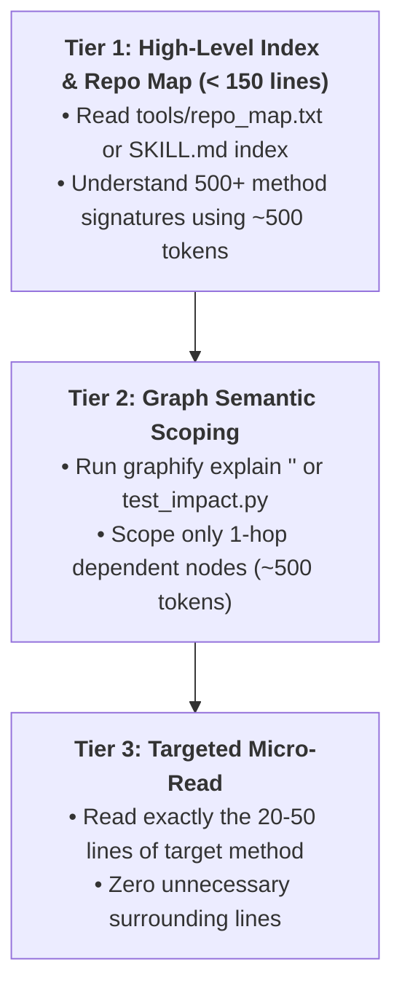

# Context Engineering & Token Optimization Protocol

*(Synthesized from `muratcankoylan/Agent-Skills-for-Context-Engineering`, `alexgreensh/token-optimizer`, and `obra/superpowers`)*

This mandatory protocol governs how AI Agents manage context windows, tool outputs, and attention budgets across automated test suites.

---

## 1. Pillar 1: Observation Masking

1. **The Principle:**
   - Raw tool outputs (CLI execution logs, Gradle builds, browser console traces) contain 90% repetitive noise and low-signal tokens.
   - Dumping raw logs degrades the LLM's reasoning ("Context Rot" / "Lost-in-the-Middle").

2. **Actionable Rules:**
   - **Log Truncation & Summarization:** When executing CLI commands, never dump thousands of lines into the active conversation. Extract only:
     - The exact failing line number and exception name.
     - The test case identifier (`TC-xxx`).
     - Final execution status (PASS/FAIL).
   - **Pointer Masking:** Use structured references pointing to files on disk:
     `[Full raw log saved to file://<path>; 2,400 verbose lines omitted]`

---

## 2. Pillar 2: Progressive Disclosure

1. **The Principle:**
   - Never load large codebases or giant classes (over 500 lines) into context at once.
   - Load information in 3 progressive tiers:

2. **Actionable Rules:**
   - Always inspect `tools/repo_map.txt` or query the Knowledge Graph (`graphify-out/graph.json`) before opening code files.
   - Use line-range parameters (`StartLine`, `EndLine`) when reading large Page Classes.

---

## 3. Pillar 3: KV-Cache Friendly Ordering

1. **The Principle:**
   - Modern LLM inference engines cache Key-Value (KV) attention states for identical prompt prefixes.
   - Any dynamic mutation in the middle of a prompt destroys the cache breakpoint, forcing 100% full re-computation.

2. **Actionable Rules:**
   - **Static Prefix First:** Maintain system instructions, rules, and tool schemas completely immutable at the top.
   - **Append-Only Dynamic State:** Only append new test results, user queries, and tool observations at the bottom of the context sequence.
   - **Predictable Format:** Use the identical pre-flight confirmation header on every turn to maximize KV-cache hit rates (aiming for > 85% cache hit).

---

## 4. Pillar 4: Scoped Context & Compaction Anchoring Protocol

1. **The Principle:**
   - Antigravity automatically triggers **Context Compaction** when conversation context approaches the ~135k tokens safety threshold to summarize session history and avoid out-of-memory crashes.
   - Without deterministic disk anchoring, automated compaction can cause lossy compression of fine-grained execution state (exact failing lines, temporary IDs, active watchpoints).
   - Furthermore, unbounded parallel sub-agents can collide on shared files, browser sessions, or database test data.

2. **Actionable Rules:**
   - **Compaction State Anchoring:** All critical state (test execution status, defect registers, active test IDs) must be persisted to disk in `PROJECT_STATE.md` or `.project_state.properties`. When compaction fires, the agent re-anchors immediately by inspecting the disk state with zero memory degradation.
   - **Workspace Isolation (`Workspace: 'share'`):** When launching sub-agents via `invoke_subagent`, always use isolated worktrees (`share` or `branch`) to prevent git index conflicts and dirty tree collisions.
   - **Zero Context Contagion:** Sub-agent tool executions (e.g., 2,000 lines of CLI stdout) remain strictly sandboxed within the sub-agent's context. Sub-agents must return only distilled 3-5 line summaries to the Lead Orchestrator.
   - **Data Partitioning by Agent ID:** Every sub-agent must append its agent identifier to dynamic test data (`uniqueCode = "AUTO_" + System.currentTimeMillis() + "_SUB" + agentId`) and use dedicated user sessions to prevent web session evictions.

---

## 5. Pillar 5: Semantic Context Distillation (Pure Signal, Zero Noise)

1. **The Principle:**
   - LLM reasoning degrades as context length increases ("Lost in the Middle"). Dumping raw HTML DOM or 1,000-line logs degrades reasoning ability.
   - All sensory inputs must pass through deterministic filters before reaching the LLM's attention heads (aiming for 300–500 tokens of 100% pure signal).

2. **Actionable Rules:**
   - **CLI Logs (`tools/distill_log.py`):** Automatically truncate 95% of verbose lines, preserving only the direct failing line, root cause exception, and the last 3 HTTP requests.
   - **DOM Purifier (`qa.getCompactAOM` in `browser_helpers.js`):** **Strictly forbidden to send raw HTML.** Use `qa.getCompactAOM(maxDepth=3)` to extract only interactive nodes with Role, Name, State, and TestId.
   - **Framework Independence (`tools/universal_ir.py`):** Author and reason over clean Universal IR representation before emitting framework-specific boilerplate (Groovy, TS, Java).
