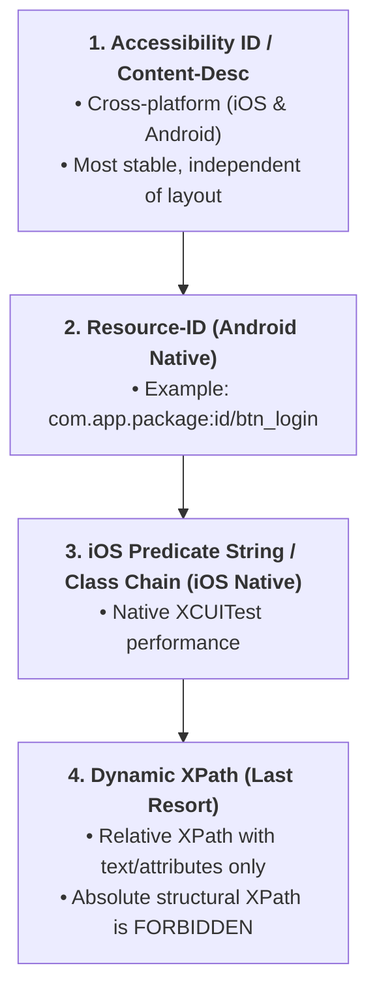

# Mobile Automation Standards & Appium Rules (Enterprise Standard)

> **Scope:** Applies to all Mobile Test Automation tasks using Appium, UIAutomator2 (Android), and XCUITest (iOS).  
> **Objective:** Deliver resilient, independent, flake-free mobile suites supporting parallel multi-device execution.

---

## 1. Native Locator Priority Hierarchy

When interacting with Native or Hybrid mobile applications, agents **MUST** strictly adhere to the following locator priority order:



### Standard Implementation Examples:
```java
// 1. Accessibility ID (Top priority)
driver.findElement(AppiumBy.accessibilityId("btn_login"));

// 2. Resource-ID Android (Android Native priority)
driver.findElement(AppiumBy.id("com.enterprise.app:id/input_username"));

// 3. iOS Predicate String (iOS Native priority)
driver.findElement(AppiumBy.iOSNsPredicateString("label == 'Sign In' AND visible == 1"));

// 4. iOS Class Chain
driver.findElement(AppiumBy.iOSClassChain("**/XCUIElementTypeButton[`label == 'Submit'`]"));
```

---

## 2. Strict Anti-Patterns & Prohibitions

- ❌ **FORBIDDEN: Absolute XPath based on DOM tree hierarchy:**
  ```java
  // STRICTLY FORBIDDEN:
  driver.findElement(By.xpath("//android.widget.FrameLayout[1]/android.widget.LinearLayout[2]/android.widget.Button[1]"));
  ```
- ❌ **FORBIDDEN: Static sleeps (`Thread.sleep()`):** Introduces pipeline latency and flaky synchronization.
- ❌ **FORBIDDEN: Interacting with off-screen elements without scrolling:** Always scroll into view first.
- ❌ **FORBIDDEN: Hardcoded device identifiers:** UDID, Device Name, Platform Version must be dynamic via environment variables or profile configurations.

---

## 3. Screen Object Model (SOM) Architecture

Following the Page Object Model design pattern, mobile test code adheres to **Screen Object Model**:
- Screen class names must end with the `Screen` suffix (e.g., `LoginScreen.java`, `HomeScreen.java`, `CartScreen.java`).
- Extend `BaseScreen` providing shared AppiumDriver instances and gesture helpers.
- Encapsulate locators within Screen classes; test scripts call business actions only.

```java
public class LoginScreen extends BaseScreen {
    private final By btnLogin = AppiumBy.accessibilityId("btn_submit");
    private final By txtEmail = AppiumBy.accessibilityId("input_email");

    public LoginScreen(AppiumDriver driver) {
        super(driver);
    }

    public HomeScreen loginWithValidCredentials(String email, String password) {
        waitForElementVisible(txtEmail).sendKeys(email);
        // ...
        return new HomeScreen(driver);
    }
}
```

---

## 4. Synchronization & Smart Mobile Waits

- Always use `WebDriverWait` with explicit `Duration`:
  ```java
  WebDriverWait wait = new WebDriverWait(driver, Duration.ofSeconds(15));
  wait.until(ExpectedConditions.visibilityOfElementLocated(AppiumBy.accessibilityId("welcome_banner")));
  ```
- Smart scroll into view:
  ```java
  // Android UIAutomator Scrollable
  driver.findElement(AppiumBy.androidUIAutomator(
      "new UiScrollable(new UiSelector().scrollable(true))" +
      ".scrollIntoView(new UiSelector().text(\"Confirm\"))"
  ));
  ```

---

## 5. Mobile Lifecycle & Device Gestures

1. **Auto-Grant Permissions:**
   - Configure capabilities to auto-grant system permissions:
     `capabilities.setCapability("autoGrantPermissions", true);` (Android) or `"permissions": "{\"com.app\": {\"camera\": \"yes\"}}"` (iOS).
2. **Screen Orientation:**
   - Verify layout adaptability in both Portrait and Landscape when supported by the application.
3. **App Backgrounding:**
   - Test application resilience across background/foreground transitions:
     `driver.runAppInBackground(Duration.ofSeconds(5));`
4. **Virtual Keyboard Handling:**
   - Always dismiss virtual keyboards (`driver.hideKeyboard()`) after input to prevent occluding action buttons.

---

## 6. Driver Architecture & Image-Based Matching

> *Borrowed and adapted from the Appium driver/plugin architecture concepts (Apache-2.0, appium/appium).*

1. **Driver isolation** — each platform driver (UIAutomator2, XCUITest)
   encapsulates its own locator translation and gesture mapping; Screen Object
   classes must never branch on driver type outside the driver layer. A
   `*Screen` class speaks intent ("tap primary action"), the driver layer
   speaks mechanics.
2. **Capabilities belong in profiles, not scripts** — device/OS/app
   capabilities live in versioned capability profiles; test classes receive a
   ready session. Hardcoding `platformVersion`/`deviceName` inside scripts is a
   prohibited anti-pattern (see Section 2).
3. **Image-based matching is a last-resort locator** — for canvas/maps/WebView
   hybrids where the accessibility tree is empty, an image-reference plugin
   (template match against a committed reference screenshot with a similarity
   threshold, e.g. ≥ 0.9) may resolve elements. It is slower and flakier than
   `AccessibilityID`/`ResourceID` — use only after the locator hierarchy in
   Section 1 is exhausted, and always commit the reference image next to the
   Screen class.
4. **Match the session teardown to the driver lifecycle** — quit sessions
   explicitly; orphaned driver processes leak devices in the grid.
