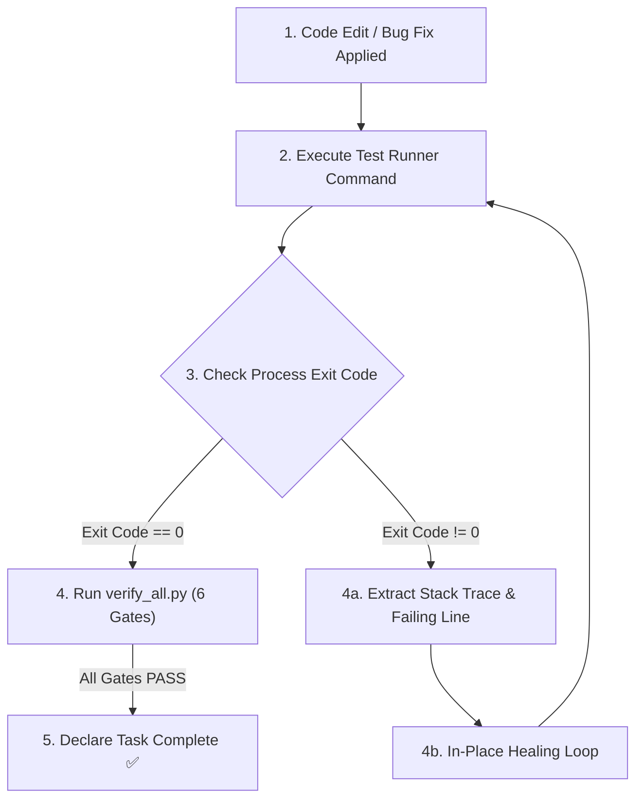

# Antigravity Test Sentinel — Verification-First Gatekeeper

The **Antigravity Test Sentinel** enforces absolute engineering integrity across test creation, script refactoring, and bug fixes. It acts as an autonomous circuit breaker that physically prohibits the AI Agent from concluding a task without verifiable proof of test execution success.

---

## 1. The Sentinel Axiom (Zero-Hallucination Gate)

1. **The Core Rule:**
   - Writing code is NOT completing the task.
   - Editing a locator is NOT fixing a failure.
   - **A task is ONLY complete when the test execution returns Exit Code 0.**

2. **Prohibited Agent Behaviors:**
   - 🚫 Saying *"I have fixed the issue"* without executing verification.
   - 🚫 Assuming a locator or script will work based on static text analysis.
   - 🚫 Ignoring non-zero exit codes from CLI runners or Gradle builds.

---

## 2. Gate-Lock Protocol

Whenever an Agent modifies any test script, Page Class, locator, or helper method:



1. **Step 1: Execute Runner Command:**
   - Run the targeted test case or test suite via headless CLI runner or verification gate:
     ```bash
     synapse verify
     ```
2. **Step 2: Inspect Exit Code:**
   - If the process terminates with exit code != 0, the task is **LOCKED**.
   - The Agent must not ask the user for confirmation or declare success.
3. **Step 3: Self-Diagnosis & Auto-Healing:**
   - The Agent must parse the exact error exception and stack trace from the failure output.
   - Apply targeted in-place healing and re-execute.
4. **Step 4: Definition of Done Verification:**
   - Run `synapse verify` to confirm all 6 quality gates pass.

---

## 3. Sentinel Status Header

In accordance with Antigravity operating discipline, include the sentinel verification status in the session summary:

```text
> 🛡️ SENTINEL STATUS: VERIFIED (Exit Code: 0 | 6/6 Gates PASS)
```
