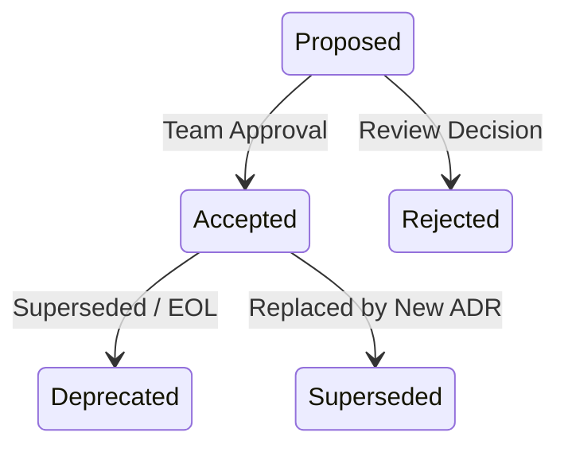

# Architecture Decision Records (ADR) Skill

> **Target:** Standardize technical decision logs, architectural trade-offs, and design rationale across enterprise testing platforms.

---

## 1. When to Use

- Documenting significant framework, toolchain, or database decisions.
- Recording architecture changes (e.g. Clean POM flat architecture vs BDD layer).
- Capturing security, authentication, or CI/CD migration trade-offs.
- Onboarding engineers and providing institutional architectural memory.

---

## 2. ADR Lifecycle State Machine



---

## 3. Standard Lightweight ADR Format

Create decision records inside `docs/adr/ADR-XXXX-<title>.md`:

```markdown
# ADR-0001: Adopt Clean POM Flat Architecture

## Status
Accepted

## Context
E2E automated test suites suffered from high maintenance overhead, locator duplication, and flaky runs caused by deeply nested inheritance hierarchies and raw selectors scattered across test scripts.

## Decision
Enforce a 2-tier Clean Page Object Model:
1. All test scripts live in `tests/` and contain only business action calls.
2. All locators and DOM operations live in Page Classes inheriting directly from `BasePage`.
3. Raw XPaths and CSS selectors are strictly prohibited in test scripts.

## Consequences
- **Positive:** Zero locator duplication, modular self-healing, faster onboarding.
- **Negative:** Requires refactoring legacy tests to encapsulate DOM calls into Page Classes.
- **Compliance:** Enforced in CI via `tools/verify_all.py` (Gate 3).
```

---

## 4. Best Practices

- Keep ADRs concise (< 500 words per decision).
- Store ADRs as markdown versioned alongside code in `docs/adr/`.
- Never modify an accepted ADR to change history; author a new ADR that supersedes the previous one.
