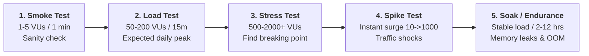

# Backend Load & Stress Testing Patterns (k6 & Locust Orchestrator)

> **Purpose:** Master backend performance, throughput, and scalability engineering. Directs AI agents to model concurrent Virtual User (VU) traffic, execute stress/soak test profiles, and enforce automated SLA gates (P95/P99 latency, error rate < 0.1%) to detect bottlenecks before production release.

---

## 1. Five Core Performance Test Archetypes



| Test Archetype | Virtual Users (VUs) | Duration | Primary Objective | Failure Indicator |
| :--- | :--- | :--- | :--- | :--- |
| **Smoke Test** | 1 - 5 VUs | 1 - 2 mins | Script syntax & endpoint health sanity | Any HTTP 5xx or unhandled exceptions |
| **Load Test** | 50 - 200 VUs | 15 - 30 mins | Verify system SLA under standard peak traffic | P95 latency > 500ms or error rate > 0.1% |
| **Stress Test** | 200 -> 2,000+ VUs | 30 - 60 mins | Identify maximum throughput and degradation cliff | DB connection pool exhaustion, 503/504 errors |
| **Spike Test** | 10 -> 1,000 VUs in 10s | 5 - 10 mins | Test autoscaling latency and rate limiters | Gateway timeout (504), service unresponsiveness |
| **Soak Test** | 50 - 100 VUs | 2 - 12 hours | Detect slow memory leaks, disk fill, thread locks | Degraded throughput over time, JVM OOM |

---

## 2. Automated SLA Threshold Assertions

Every performance test execution must assert measurable SLA criteria. If thresholds fail, the CI/CD pipeline returns a non-zero exit code.

```javascript
// Enterprise SLA Gates (k6)
export const options = {
  thresholds: {
    // 95% of requests must complete under 500ms
    http_req_duration: ['p(95)<500', 'p(99)<1000'],
    // Request failure rate must stay under 0.1%
    http_req_failed: ['rate<0.001'],
    // Functional checks must maintain > 99.9% success
    checks: ['rate>0.999'],
  },
};
```

---

## 3. Production-Ready k6 Load Script (TypeScript / JavaScript)

```javascript
import http from 'k6/http';
import { check, sleep } from 'k6';
import { Counter, Rate, Trend } from 'k6/metrics';

// Custom Enterprise Metrics
const errorRate = new Rate('custom_error_rate');
const searchLatency = new Trend('search_latency');

export const options = {
  scenarios: {
    enterprise_workload: {
      executor: 'ramping-vus',
      startVUs: 0,
      stages: [
        { duration: '2m', target: 50 },   // Ramp-up to 50 users
        { duration: '5m', target: 50 },   // Steady state peak
        { duration: '2m', target: 150 },  // Surge stress load
        { duration: '3m', target: 150 },  // Sustained stress
        { duration: '2m', target: 0 },    // Ramp-down to 0
      ],
      gracefulRampDown: '30s',
    },
  },
  thresholds: {
    http_req_duration: ['p(95)<400', 'p(99)<800'],
    custom_error_rate: ['rate<0.005'], // < 0.5% errors under stress
  },
};

const BASE_URL = __ENV.TARGET_URL || 'https://api.staging.enterprise.local';

export function setup() {
  // Pre-test Authentication & Seeding (Executed once)
  const authRes = http.post(`${BASE_URL}/api/v1/auth/login`, JSON.stringify({
    username: __ENV.PERF_USER || 'perf_agent_01',
    password: __ENV.PERF_PASSWORD || 'SecretVault#2026',
  }), { headers: { 'Content-Type': 'application/json' } });

  check(authRes, { 'Auth 200 OK': (r) => r.status === 200 });
  const token = authRes.json('token');
  return { token };
}

export default function (data) {
  const params = {
    headers: {
      'Authorization': `Bearer ${data.token}`,
      'Content-Type': 'application/json',
      'X-Correlation-ID': `PERF-${__VU}-${__ITER}-${Date.now()}`,
    },
  };

  // 1. Transaction A: Fast Read API
  const resGet = http.get(`${BASE_URL}/api/v1/catalogs?limit=20`, params);
  const getOk = check(resGet, {
    'Catalog GET 200': (r) => r.status === 200,
    'Catalog Payload Valid': (r) => r.json('data.items') !== undefined,
  });
  errorRate.add(!getOk);
  searchLatency.add(resGet.timings.duration);

  sleep(1);

  // 2. Transaction B: Dynamic Mutation API
  const payload = JSON.stringify({
    code: `AUTO_PERF_${__VU}_${__ITER}_${Date.now()}`,
    name: 'Dynamic Synthetic Benchmark Item',
    active: true,
  });

  const resPost = http.post(`${BASE_URL}/api/v1/catalogs`, payload, params);
  const postOk = check(resPost, {
    'Catalog POST 201': (r) => r.status === 201 || r.status === 200,
  });
  errorRate.add(!postOk);

  sleep(2);
}

export function teardown(data) {
  // Clean up benchmark markers if required
}
```

---

## 4. Production-Ready Locust Load Script (Python)

```python
import os
import time
from locust import HttpUser, task, between, events

class EnterpriseBackendUser(HttpUser):
    wait_time = between(1.0, 2.5)  # Realistic user think-time

    def on_start(self):
        """Initial authentication handshake per Virtual User."""
        res = self.client.post("/api/v1/auth/login", json={
            "username": os.getenv("PERF_USER", "perf_tester"),
            "password": os.getenv("PERF_PWD", "SecretPass2026")
        })
        if res.status_code == 200:
            token = res.json().get("token")
            self.client.headers.update({"Authorization": f"Bearer {token}"})

    @task(3)
    def query_search_index(self):
        """High-frequency read query."""
        with self.client.get("/api/v1/search?q=enterprise&page=1", catch_response=True) as response:
            if response.status_code != 200:
                response.failure(f"Search API failed with HTTP {response.status_code}")
            elif response.elapsed.total_seconds() > 0.5:
                response.failure(f"Search API SLA breached (>500ms): {response.elapsed.total_seconds():.3f}s")

    @task(1)
    def submit_order_transaction(self):
        """Mutation transaction with dynamic unique identifier."""
        order_id = f"ORDER_PERF_{time.time_ns()}"
        with self.client.post("/api/v1/orders", json={
            "orderCode": order_id,
            "items": [{"sku": "SKU-990", "quantity": 1}],
            "totalAmount": 150000
        }, catch_response=True) as response:
            if response.status_code not in (200, 201):
                response.failure(f"Order submission failed: {response.text}")
```

---

## 5. Execution Runbook & CI/CD Integration

### Run k6 Headless with JSON Summary
```bash
# Execute 100-user load test and export raw metrics
k6 run --out json=reports/k6_metrics.json tests/load/k6_catalog_load.js

# Assert exit code in CI/CD pipeline
if [ $? -ne 0 ]; then
  echo "❌ Performance SLA threshold breached!"
  exit 1
fi
```

### Run Locust Headless in CI/CD
```bash
locust -f tests/load/locustfile.py --headless -u 100 -r 10 --run-time 5m \
       --host https://api.staging.enterprise.local \
       --html reports/locust_report.html \
       --exit-code-on-error 1
```

### Autonomous Apache JMeter 360° Pinnacle Suite (Full-Stack & Multi-Protocol)
Hub provides complete enterprise lifecycle automation for Apache JMeter 5.x via `generate_jmx_plan.py`, `jtl_analyzer.py`, and `telemetry_correlator.py`:

```bash
# 1. Generate Full Enterprise Plan with Pareto Traffic Shaping (70/20/10) & Deep Correlation
agent-qa generate-jmx --spec swagger.json -o perf_plan.jmx \
  --workload spike --vus 200 --duration 600 \
  --weighted-mix "70:Browse,20:Cart,10:Checkout" \
  --csv-data users.csv --deep-correlation --jsr223-hmac

# 2. Multi-Protocol Load Plans (WebSocket, gRPC, Kafka, JDBC)
agent-qa generate-jmx --ws-sample -o websocket_plan.jmx      # Real-time WebSocket feed
agent-qa generate-jmx --grpc-sample -o grpc_plan.jmx        # Microservices Unary RPC
agent-qa generate-jmx --kafka-sample -o kafka_plan.jmx      # Event-driven message broker
agent-qa generate-jmx --jdbc-sample -o jdbc_plan.jmx        # Direct Database SQL pool

# 3. Live APM Telemetry & PerfMon Hardware Agent
agent-qa generate-jmx --spec swagger.json -o perf_plan.jmx \
  --influxdb-url http://influxdb:8086/write?db=jmeter \
  --perfmon-server 192.168.1.50:4444

# 4. Distributed Cluster Execution (Master + 3 Slaves)
docker-compose -f tools/templates/jmeter-distributed/docker-compose.yml up -d
jmeter -n -t perf_plan.jmx -R slave1,slave2,slave3 -l results.jtl

# 5. CI/CD SLA Quality Gate Enforcement (Exit code 0 on Pass, 1 on Breach)
agent-qa analyze-jtl results.jtl --sla-p95 500 --max-error-rate 1.0 \
  --markdown pr_perf_report.md --json metrics.json

# 6. Full-Stack APM & Server Infrastructure RCA Correlator
agent-qa correlate-telemetry --jtl results.jtl --server-metrics server_metrics.csv \
  --markdown rca_report.md
```

---

## 6. Performance Engineering Checklist
- [ ] Authentication executed once per VU in `setup()` or `on_start()`, never in tight loops.
- [ ] Synthetic transactions use dynamic unique codes to eliminate DB primary key collisions.
- [ ] SLA thresholds include both latency (P95/P99) and availability (`error_rate < 0.1%`).
- [ ] Soak tests executed against isolated staging environments with active APM/DB monitoring.
- [ ] Teardown removes temporary benchmark data to prevent DB bloat.
