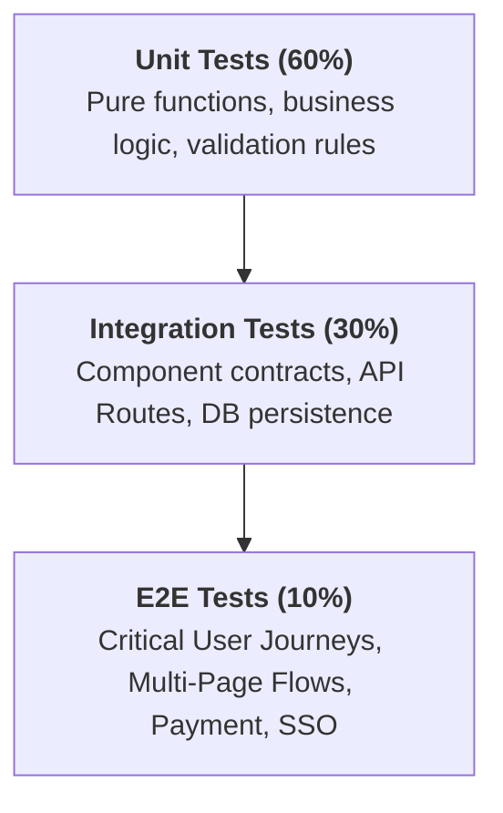

# E2E Testing Architectural Patterns

Engineering standard for structuring, scaling, and maintaining large-scale End-to-End (E2E) test automation suites across modern web frameworks (React, Angular, Vue, Next.js).

---

## 1. Test Pyramid & E2E Scope Boundary



- **What belongs in E2E:** High-risk customer journeys (Sign-up, Onboarding, Checkout, File Export, Role transitions).
- **What to avoid in E2E:** Exhaustive boundary value checks of simple form fields (delegate to Unit/API tests).

---

## 2. Core Operational Patterns

### Pattern A: Clean Page Object Model (POM) with Typed Interfaces
```typescript
// pages/base.page.ts
import { Page, Locator, expect } from '@playwright/test';

export abstract class BasePage {
  constructor(protected readonly page: Page) {}

  async waitForNetworkIdle(): Promise<void> {
    await this.page.waitForLoadState('networkidle');
  }

  async clickSafe(locator: Locator): Promise<void> {
    await locator.waitFor({ state: 'visible' });
    await locator.click();
  }
}
```

```typescript
// pages/checkout.page.ts
import { Locator, expect } from '@playwright/test';
import { BasePage } from './base.page';

export class CheckoutPage extends BasePage {
  readonly submitBtn: Locator = this.page.getByRole('button', { name: /Complete Purchase/i });
  readonly confirmationToast: Locator = this.page.getByTestId('checkout-toast');

  async completeOrder(): Promise<void> {
    await this.clickSafe(this.submitBtn);
    await expect(this.confirmationToast).toBeVisible({ timeout: 5000 });
  }
}
```

### Pattern B: Isolated Storage State Fixture (Zero Login Repetition)
```typescript
// fixtures/auth.fixture.ts
import { test as base, Page } from '@playwright/test';

export const test = base.extend<{ authedPage: Page }>({
  authedPage: async ({ browser }, use) => {
    const context = await browser.newContext({ storageState: '.auth/user.json' });
    const page = await context.newPage();
    await use(page);
    await context.close();
  },
});
```

### Pattern C: Resilient Synchronization (No Static Delays)
```typescript
// ANTI-PATTERN:
// await page.waitForTimeout(5000); // Flaky and slow!

// CORRECT PATTERN:
// 1. Wait for specific API response
const responsePromise = page.waitForResponse(resp => resp.url().includes('/api/orders') && resp.status() === 201);
await page.getByRole('button', { name: 'Save' }).click();
await responsePromise;

// 2. Assert final visual DOM state
await expect(page.getByText('Order Created')).toBeVisible();
```

---

## 3. Parallel Sharding & CI/CD Governance
```bash
# Run test suite sharded across 4 parallel CI workers
npx playwright test --shard=1/4 --reporter=html,junit:results.xml
```
- **Retries:** Maximum 1 retry on CI, 0 retries locally. Never rely on retries to mask structural flakiness.
- **Trace on Failure:** Always configure `trace: 'retain-on-failure'` and `screenshot: 'only-on-failure'`.
