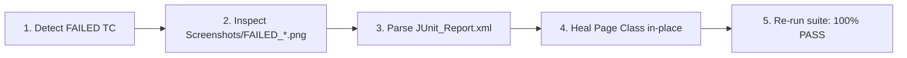

# Failure Autopsy & Auto-Healing (Diagnostic & Self-Healing Engine)

Specialized skill for diagnosing batch test execution failures across automated test cases, performing visual autopsies via `Screenshots/FAILED_*.png`, parsing `JUnit_Report.xml`, and healing Page Classes (`Keywords/<namespace>/pages/*.groovy` or `pages/*.ts`) in place.

---

## 1. Five-Step Enterprise Autopsy Protocol



1. **Zero-Token Triage:** Pinpoint failed line and cause instantly (<50 tokens):
   ```bash
   python3 tools/pinpoint_failure.py
   # or bash .agents/skills/failure-autopsy-and-healing/scripts/triage_failures.sh
   ```
2. **Visual Autopsy:** Inspect the latest error screenshot to immediately detect: disabled buttons, missing required fields, UI overlaps, or obscuring modal backdrops.
3. **XML Parsing:** Extract stacktrace and exception messages from `Reports/<Timestamp>/JUnit_Report.xml` or Playwright test results.
4. **In-Place Healing:** Update the corresponding Page Class in `Keywords/<project_namespace>/pages/` or `pages/`.
5. **Regression Guard:** Verify 100% UTF-8 No BOM and re-run the targeted suite to confirm 100% Pass.

---

## 2. Dynamic Module & Page Class Mapping Architecture

| Functional Module Category | Target Page Class to Heal | Common Failure Vector | Recommended Auto-Heal Strategy |
| :--- | :--- | :--- | :--- |
| **Authentication & Session** | `LoginPage` | Stale session, cookie expiration | Switch to zero-second storage state / token injection |
| **System Admin & RBAC** | `UserAdminPage` | Role permission dialog overlay | Smart wait for dialog animation + backdrop dismissal |
| **Master Data & Catalogs** | `CategoryPage` | Table virtualization lazy-load | Scroll into view + waitForLoadState('networkidle') |
| **Workflows & Approvals** | `PlanningPage` | Button disabled state / slow API | Await formControl valid state before trigger click |
| **Data Tables & Search** | `DataManagementPage`| Dynamic table pagination index | Target semantic cell content or unique row testid |
| **Reporting & Exports** | `ReportPage` | Background worker generation lag | Poll download trigger with timeout rather than static wait |
| **API & Integrations** | `ApiTokenPage` | Bearer token header mismatch | Validate token generation response payload schema |

---

## 3. Reference Documentation

- [**Diagnostic & Healing Matrix (`healing_matrix.md`)**](references/healing_matrix.md): Concrete code prescriptions for disabled buttons, boundary overlaps, `ElementClickInterceptedException`, `StaleElementReferenceException`, and 4 flaky test root causes.
- [**Fast-Fix Triad & Runtime Helper (`tools/browser_helpers.js`)**](tools/browser_helpers.js): In-browser diagnosis engine via `window.__qa` (`audit`, `heal`, `clickSafe`, `hud`).
- **Automated Triage Script:** `python3 tools/pinpoint_failure.py` and `scripts/triage_failures.sh`.
