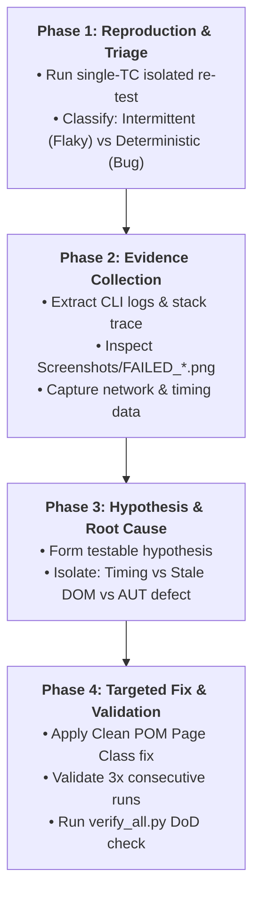

# QA Investigation & Root-Cause Analysis Protocol

*(Inherited from `fugazi/test-automation-skills-agents`)*

A file-backed, evidence-first investigation journal protocol for diagnosing failing and flaky automation test cases in enterprise automation projects.

---

## 1. Core Principles

1. **Context Window is Volatile RAM; Filesystem is Persistent Disk:**
   - Long triage sessions cause context drift. All goals, hypotheses, and evidence must be logged in markdown.
2. **Discovered Classification, Not Presumed:**
   - Never assume upfront whether a failure is a Flaky test, an AUT Defect, or a Test Infrastructure issue. The classification is a finding discovered through evidence.
3. **No Guesswork / No Blind Fixes:**
   - Every fix must address a proven root cause, not a symptom.

---

## 2. Four-Phase Investigation Cycle

### Phase 1: Reproduction & Triage
- Run the failing test in isolation using the targeted single-TC runner.
- Determine failure pattern:
  - **Deterministic Bug:** Fails 100% of the time with identical stack trace.
  - **Intermittent Flaky:** Passes sometimes, fails under load/timing variations.
  - **Environment Blocker:** Fails on 401/403 session expiration or network timeout.

### Phase 2: Evidence Collection
- Collect ground-truth artifacts:
  1. CLI log excerpt around the failure point.
  2. Failure screenshot in `Screenshots/FAILED_<TestCaseId>_*.png`.
  3. Form audit state (e.g. disabled Save button, red validation borders).
  4. Redact any sensitive credentials or personal tokens.

### Phase 3: Hypothesis Formulation
- Check the 4 most common failure archetypes:
  - **Archetype A (PrimeNG Toast Collision):** Previous toast covers the button. Cure: `dismissToast()`.
  - **Archetype B (Stale Element / Angular Re-render):** DOM re-created mid-click. Cure: Re-fetch locator with `BasePage.x()`.
  - **Archetype C (Dialog Backdrop Overlay):** `cdk-overlay-backdrop` blocks click. Cure: Wait for backdrop fade-out.
  - **Archetype D (Real AUT Defect):** Backend HTTP 500 or constraint violation. Cure: Log to `KNOWN_ISSUES.md`.

### Phase 4: Targeted Fix & Validation
- Implement fix exclusively inside Page Classes in `Keywords/<namespace>/pages/` or `pages/` (never in `Scripts/`).
- Validate stability across multiple runs.
- Run `python3 tools/verify_all.py` to confirm zero regressions.
