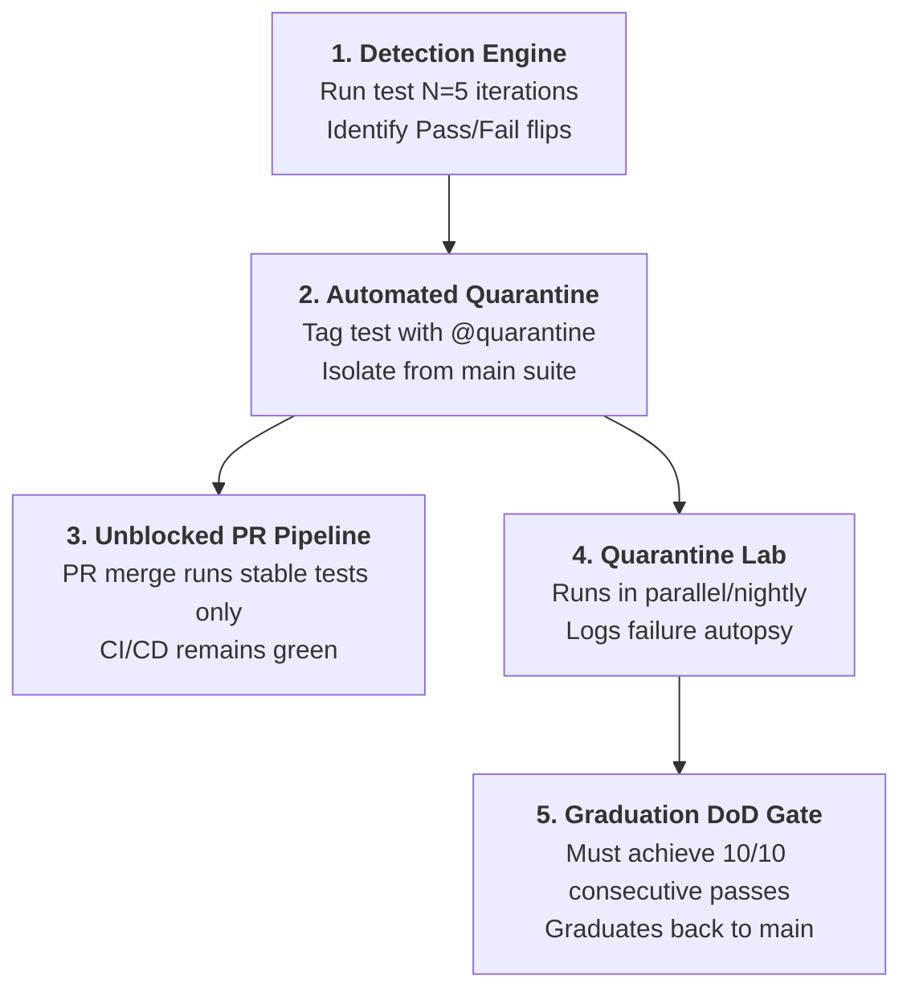

# Flaky Test Sentinel & Quarantine Protocol

> **Purpose:** Master flaky test governance, automated quarantine isolation, and non-deterministic test remediation. Eliminates false-positive CI/CD pipeline blockers by identifying unstable tests through repeated execution ($N=5$), moving them into isolated quarantine suites, and tracking remediation until graduation.

---

## 1. The Flaky Test Dilemma & The 5-Stage Quarantine Lifecycle

In large enterprise test suites (hundreds to thousands of test cases), non-deterministic tests ("flaky tests" that intermittently pass and fail without code changes) erode trust in CI/CD, slow down deployments, and cause developers to ignore test results.



---

## 2. Flakiness Scoring Formula & Classification

$$P = \frac{\text{Passed Executions}}{N} \times 100\% \quad \text{where } N \ge 5$$

$$\text{Flip Rate} = \frac{\text{Status Transitions (Pass} \leftrightarrow \text{Fail)}}{N - 1} \times 100\%$$

| Health Tier | Pass Rate ($P$) | Flip Count ($N=5$) | Action Required | Pipeline Impact |
| :--- | :--- | :--- | :--- | :--- |
| **STABLE (Green)** | $100\%$ | 0 flips | Kept in standard regression suite | Blocks PR on real bug |
| **MILD FLAKE** | $80\% \le P < 100\%$ | 1 - 2 flips | Log warning; monitor over 24 hours | Kept in suite with watchpoint |
| **SEVERE FLAKE** | $P < 80\%$ | $\ge 2$ flips | **Immediate Quarantine Tagging (`@quarantine`)** | Excluded from PR merge blocker |
| **DEAD TEST / BROKEN**| $0\%$ | 0 flips | File critical AUT/Test bug defect | Regular test failure |

---

## 3. Quarantine Tagging & Execution Strategies

### Playwright / TypeScript Quarantine Tagging
```typescript
import { test, expect } from '@playwright/test';

// Before Quarantine: Unstable test intermittently blocking main PRs
// test('TC-104: Submit monthly reconciliation report', async ({ page }) => { ... });

// After Quarantine: Tagged with @quarantine metadata
test('TC-104: Submit monthly reconciliation report @quarantine', async ({ page }) => {
  // Test code remains intact for debugging
  await page.goto('/reports/reconciliation');
  // ...
});
```

### CI/CD Filter Configuration
```bash
# 1. Main PR Blocker Suite: Runs ONLY 100% stable tests (Zero Flaky Disruptions)
npx playwright test --grep-invert "@quarantine"

# 2. Nightly Quarantine Lab: Runs quarantined tests to collect diagnostics & heal
npx playwright test --grep "@quarantine" --reporter=json
```

---

## 4. Automated Multi-Run Flakiness Detector Tool

This repository provides an automated flakiness analyzer in `tools/flaky_detector.py`.

### Running 5-Iteration Flakiness Benchmark
```bash
# Run a specific test script 5 consecutive times to benchmark stability
synapse flaky --repeat 5 --cmd "npm test -- tests/e2e/TC-104.spec.ts"

# Or parse existing test execution history
synapse flaky --reports "reports/**/junit*.xml"
```

Output Report (`reports/quarantine_board.json`):
```json
{
  "test_id": "TC-104",
  "iterations": 5,
  "passes": 3,
  "failures": 2,
  "pass_rate": 60.0,
  "flakiness_status": "SEVERE_FLAKE",
  "quarantine_recommended": true,
  "probable_cause": "Angular PrimeNG animation fade-out / missing smart wait"
}
```

---

## 5. Root-Cause Remediation Guide (Heal & Graduate)

| Flakiness Root Cause | Anti-Pattern | Mandatory Remediation |
| :--- | :--- | :--- |
| **Race Condition** | Static `Thread.sleep(3000)` or blind delays | Replace with Smart Wait: `waitForLoadState('networkidle')` or Angular `zone.isStable()`. |
| **Database Collision** | Reusing static IDs (`"ORDER_001"`) | Use dynamic identifiers: `BasePage.uniqueCode("AUTO_")` paired with Idempotent Teardown. |
| **Animation Interference**| Clicking during backdrop fade | Use `BasePage.clickJS()` or await overlay invisibility (`.p-component-overlay`). |
| **DOM Re-render Drift** | Direct click after async API fetch | Encapsulate 3-attempt retry loop with AOM Role fallback in Page Class. |

---

## 6. Graduation Definition of Done (DoD) Gate

Before removing the `@quarantine` tag and restoring a test to the main PR suite:
1. **Verification Run:** The healed test must execute **10 consecutive iterations** in headless mode with **100% Pass Rate** (`10/10 PASS`).
2. **Code Standards:** 100% UTF-8 No BOM, Clean POM flat architecture, zero hardcoded XPaths.
3. **Artifact Update:** Update `reports/quarantine_board.json` to mark status as `GRADUATED`.
