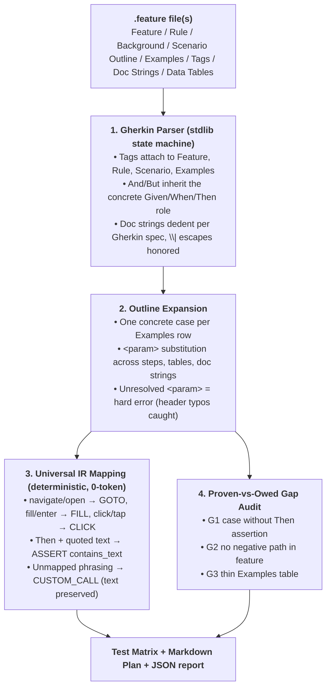

# Gherkin to Suite Compiler — Natural-Language Test Ingestion (0-Token)

This skill turns business-readable Gherkin `.feature` files into deterministic
test artifacts: an expanded test-case matrix, hub-native Universal IR for the
transpile pipeline, and a coverage-gap audit — all without a single LLM token.

> **Provenance:** Concept inspired by the Gherkin-driven E2E ingestion workflow
> popularized by TestZeus Hercules (AGPL-3.0); independently re-implemented
> from scratch for this MIT repository (no upstream code). The "proven vs
> owed" coverage traceability idea is inspired by Kane CLI (Apache-2.0).

---

## 1. When to Activate

- User supplies `.feature` / BDD specs and wants an executable test suite plan.
- Need to audit a BDD suite for missing assertions, negative paths, or thin
  example tables before codifying into Clean POM scripts.
- Need structured test data (JSON IR) to feed `omni_transpiler` / `universal_ir`
  pipelines instead of hand-writing scripts.

## 2. Pipeline



## 3. Commands

```bash
# Compile a single feature (human summary + Markdown plan to stdout)
python tools/gherkin_suite.py tests/bdd/checkout.feature

# Compile a whole directory of .feature files
python tools/gherkin_suite.py tests/bdd/

# Machine-readable report to stdout / hub Universal IR for the omni pipeline
python tools/gherkin_suite.py tests/bdd/ --json
python tools/gherkin_suite.py tests/bdd/ --emit-ir

# Via the hub CLI
agent-qa gherkin tests/bdd/
```

Exit codes: `0` = compiled (warnings allowed) · `1` = parse/authoring errors
(report and plan are still emitted so the suite can be iterated on).

## 4. Output Contract

| Artifact | Location | Content |
| :--- | :--- | :--- |
| JSON report | `reports/gherkin_suite_report.json` | Per-feature totals, expanded cases with mapped steps, errors, gaps, `health_score_pct` |
| Markdown plan | stdout | Background, per-scenario steps with mapped actions, Examples tables, gap section |
| Universal IR | `--emit-ir` stdout | `TestCaseIR` dicts (id, title, tags, `StepIR` steps) consumable by `universal_ir` / `omni_*` tooling |

## 5. Coverage-Gap Rules (proven vs owed)

| Rule | Trigger | Suggested Remedy |
| :--- | :--- | :--- |
| `G1-MISSING_ASSERTION` | Case has no Then/assert step | Add an observable outcome assertion |
| `G2-MISSING_NEGATIVE_PATH` | Feature has no invalid/error/fail scenario | Add at least one negative scenario |
| `G3-THIN_EXAMPLES` | Examples table has < 2 rows | Add boundary + negative rows (empty, max length, special chars) |
| *(error)* Unresolved `<param>` | Example header does not cover a used parameter | Fix the header typo or remove the parameter |

## 6. Limitations (Honest Scope)

- English Gherkin keywords only; `# language:` headers are ignored.
- NL→IR mapping is deterministic keyword heuristics — best-effort, not an LLM
  semantic parser; unmapped phrasing degrades to `CUSTOM_CALL` with the original
  text preserved so nothing is silently lost.
- Compilation produces the suite plan and IR; executing against a live AUT is
  the job of the target framework (Playwright/Katalon) via `omni_transpiler`
  and the `clean-pom-crafter` skill.

## 7. Reference Examples

- `examples/checkout.feature` — full-featured input (Background, Outline, two
  Examples blocks, tags, data tables).
- `examples/suite_report_sample.json` — trimmed JSON report shape emitted to
  `reports/gherkin_suite_report.json`.
