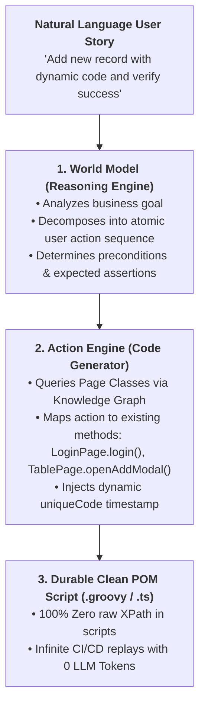
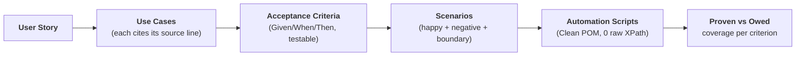

# LAM Script Generator — Large Action Model for Test Automation

Inspired by the **LaVague AI Web Agent & Large Action Model (LAM)** framework, this skill bridges the gap between natural language requirements (User Stories, Acceptance Criteria) and durable, deterministic automation code conforming to Clean POM Flat Architecture.

---

## 1. The Dual-Engine LAM Architecture



1. **World Model (Reasoning Engine):**
   - Parses natural language requirements or QA/BA Acceptance Criteria.
   - Infers the step sequence: `Login` $\rightarrow$ `Navigate to Menu` $\rightarrow$ `Open Add Modal` $\rightarrow$ `Input Dynamic Data` $\rightarrow$ `Save & Assert Toast`.
2. **Action Engine (Code Generator):**
   - Instead of speculative coordinates, Action Engine queries the project Knowledge Graph to select existing Page Classes and standardized methods.
   - Generates clean, robust test scripts adhering strictly to Clean POM.
3. **Zero-Token Replayability:**
   - Once verified, the generated script is committed to the test suite on disk.
   - All subsequent CI/CD pipeline runs execute deterministically without consuming any LLM tokens.

---

## 2. Transformation Workflow: User Story to Clean POM

### Input (User Story):
```text
"Verify adding a new Industry record:
1. Login as system administrator.
2. Navigate to Industry Data menu.
3. Click Add New button.
4. Fill required fields with dynamic code 'IND_' and valid name.
5. Save and assert green success notification.
6. Verify the new record appears in the data table."
```

### Output (Clean POM Groovy Script):
```groovy
import com.kms.katalon.core.webui.keyword.WebUiBuiltInKeywords as WebUI
import internal.GlobalVariable as GlobalVariable
import pages.LoginPage
import pages.IndustryDataPage
import common.BasePage

// 1. Arrange & Preconditions
LoginPage.login(GlobalVariable.ADMIN_USER, GlobalVariable.ADMIN_PASS)
IndustryDataPage.navigate()

// 2. Dynamic Test Data Generation
String uniqueCode = BasePage.uniqueCode("IND_")
String entityName = "Automated Test Industry " + uniqueCode

// 3. Act
IndustryDataPage.clickAddNew()
IndustryDataPage.inputDetails(uniqueCode, entityName)
IndustryDataPage.clickSave()

// 4. Assert
IndustryDataPage.assertSuccessToast()
IndustryDataPage.searchAndVerifyRecord(uniqueCode, entityName)

// 5. Teardown Cleanup
IndustryDataPage.deleteRecordByCode(uniqueCode)
```

---

## 3. Mandatory Generation Constraints
- Zero raw XPaths, CSS selectors, or `findTestObject` in the generated script.
- Always generate dynamic identifiers with prefixes via `BasePage.uniqueCode()`.
- Always generate mandatory teardown cleanup for created entities.

## 4. Proven-vs-Owed Traceability Pipeline

> *Borrowed and adapted from the Kane CLI generate→execute→prove workflow (Apache-2.0, lambdatest/kane-cli).*

Generated scripts must be traceable to the acceptance criteria they prove.
For every user story, maintain the chain:



Rules:

1. **Every generated script cites its criterion** — keep the AC id in the test
   case name or a comment header; a script nobody can trace back is a liability.
2. **Report coverage as proven vs owed, not test counts** — a criterion with no
   passing automated script is *owed*; N scripts proving one criterion is waste.
3. **Reconcile on requirement change** — when a story changes, re-run the chain
   and mark stale scripts before trusting any green run.
4. For BDD inputs, the `gherkin-to-suite` skill performs the AC→scenario
   expansion deterministically (0-token); feed its Universal IR here for
   codification.
