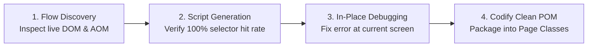

# Playwright Live Interaction & Fast Debugging Handbook (Enterprise Web & Clean POM)

Direct in-browser interaction and rapid debugging via **Playwright MCP Tools** (`browser_run_code_unsafe` / `call_mcp_tool`), executing live JavaScript/Playwright commands without rebuilding or restarting test runs.

---

## 1. Scope & Enterprise Architecture Coverage

All live web flows map strictly to the **Clean Page Object Model Architecture** (`BasePage` + Domain Page Classes in `Keywords/<project_namespace>/pages/` or `pages/*.ts`):

1. **Authentication & Session:** Login, multi-factor, session renewal, profile update, logout.
2. **Administration & RBAC:** User accounts, roles, permission matrices, tenant management.
3. **Master Data & System Catalogs:** Lookup dictionaries, unit definitions, category trees.
4. **Business Workflows & Approvals:** Multi-step submission, validation state gates, approval chains.
5. **Data Tables & Search:** Server-side pagination, two-phase search filtering, batch mutations.
6. **Reporting & Analytics:** Dashboard metrics, dynamic chart canvases, Excel/CSV exports.
7. **Integrations & API Tokens:** Token lifecycle management, webhook verification, data sharing.

### 1.1. Cross-Harness Tool Mapping (Portability Matrix)

To ensure skills operate seamlessly across different AI agent environments:

| Action / Intent | Antigravity MCP | Claude Code / Cursor / Standard Playwright MCP | Vanilla Playwright Script |
|---|---|---|---|
| **Run JS in Browser** | `browser_run_code_unsafe` | `browser_evaluate` | `page.evaluate(...)` |
| **Navigate to URL** | `browser_navigate` | `navigate_page` / `page.goto` | `page.goto(url)` |
| **Click Element** | `browser_click` | `click_element` | `page.locator(sel).click()` |
| **Inspect DOM/AOM** | `browser_snapshot` | `get_accessibility_tree` | `page.accessibility.snapshot()` |
| **Wait for State** | `browser_wait_for` | `wait_for_selector` | `page.waitForSelector(...)` |

---

## 2. Three-Stage Fast-Loop Workflow

1. **Flow Discovery:** Probe accessibility tree (`accessibility.snapshot()`) or DOM to extract live URLs, menus, and dialogs in under 2 minutes.
2. **Script Generation:** Test selectors live (`await page.locator(...).count() > 0`). Only codify when the selector hits 100% in 200ms.
3. **In-Place Debugging:** When step $N$ fails, **keep the browser paused at that step**. Use `page.evaluate()` to diagnose disabled buttons, obscuring overlays, or validation errors. Fix in place; never re-run from step 1.

---

## 3. Mapping Matrix (Playwright Live Code ↔ Clean POM)

| UI Action | Playwright Live Code (MCP) | Clean POM Groovy / Java Code | Clean POM TypeScript (Playwright) |
|---|---|---|---|
| **Fill Input** | `await page.locator(sel).fill(val);` | `WebElement el = findElement(By.cssSelector(sel)); jsSetInput(el, val);` | `await this.inputField.fill(val);` |
| **Safe Click / Overlay** | `await page.locator(sel).click();` | `WebElement el = findElement(By.cssSelector(sel)); clickElement(el);` | `await this.submitButton.click();` |
| **Dropdown Selection** | `await page.locator('p-dropdown').click(); await page.locator('.p-dropdown-item:has-text("X")').click();` | `selectDropdownByText(dropdownEl, "X")` | `await this.dropdown.selectOption("X");` |
| **Calendar Picker** | Synthetic `input` + `change` event | `jsSetInput(calendarInput, "25/10/2026")` | `await this.datePicker.fill("2026-10-25");` |
| **Catch Success Toast** | `await page.waitForSelector('.toast-success')` | `verifyToastMessage("Success")` | `await expect(this.toast).toBeVisible();` |
| **Two-Phase Search** | Click search icon -> Enter Keyword -> Enter | `searchRecord(keyword)` in Page Class | `await this.search(keyword);` |
| **Delete & Confirm** | Click Trash -> Accept Confirm -> Verify Gone | `deleteRecord(keyword)` in Page Class | `await this.delete(keyword);` |

---

## 4. Pre-Codify Quality Checklist

Mandatory 5-point verification before committing POM code:
- [x] **100% UTF-8 No BOM:** Must NOT contain `0xEF, 0xBB, 0xBF`.
- [x] **Flat Architecture:** Zero raw XPaths or unencapsulated selectors in test scripts.
- [x] **Dynamic Test Data:** Use `BasePage.uniqueCode("PREFIX_")`; no static colliding strings.
- [x] **Truth Anchor (No Fake Pass):** Real toast assertions or live data table row verification.
- [x] **Synthetic Event Dispatch:** 100% framework inputs trigger synthetic `input` and `change` events.

---

## 5. Reference Documentation (Progressive Disclosure)

- [**20 Complete UI Recipes**](references/recipes.md): Code recipes for Auth, Data Tables, Dropdowns, Modals, Confirm Dialogs, File Upload, Calendar, MultiSelect, Stale Retries, Form Audit, Smart Action Batching, and Self-Healing Locators.
- [**Runtime Browser Helper (`tools/browser_helpers.js`)**](tools/browser_helpers.js): Unified JavaScript module providing `window.__qa` (`batch`, `audit`, `heal`, `clickSafe`, `exportSession`).
- [**5 Superpowers & 5 AI Paradigms**](references/advanced_superpowers.md): Zero-Second Auth (`session.json`), Direct API Seeding, AOM Snapshots, Multi-Context Dual Role, Route Mocking, Self-Healing Locators, Fuzzing, CDP Profiling.
- [**Multi-Agent Swarm Orchestration**](references/swarm_orchestration.md): Specialized swarm roles and collaboration protocol.

## 6. Instant Action vs Auto-Planning Dispatch

> *Borrowed and adapted from the Midscene.js prompting model (MIT license, web-infra-dev/midscene).*

When driving the live browser through an AI vision model, choose the dispatch
mode deliberately — the trade-off is control vs cost:

| Mode | When to Use | Cost Profile |
| :--- | :--- | :--- |
| **Instant action** (`aiTap`, `aiInput`, `aiHover`, `aiQuery`) | You already know the exact single action; AI only locates the element | Faster and more accurate; deterministic control |
| **Auto planning** (`aiAction("<full task>")`) | Multi-step flow not yet decomposed; you want the model to plan | Flexible but costs more time and tokens; plan can drift |

Dispatch rules for agents:

1. **One task per call** — split "Click Login then fill the form" into separate
   calls; combined prompts produce messy plans.
2. **Describe position, not internals** — the model sees pixels/AOM only:
   prefer "the button at the top-right of the cart panel" over DOM properties.
3. **Assert only what is visible** — DOM internals, tab counts, or network
   state are invisible to the model; use `aiQuery` to extract data, then assert
   on the extracted value with a real assertion.
4. **Never trust the model's own success claim** — pair every instant action
   with an explicit `expect(...)`/`verify...` assertion (Truth Anchor).
5. **Debug failures in two layers** — wrong step count = planning failed (add
   flow detail); wrong element = locating failed (add spatial detail).
