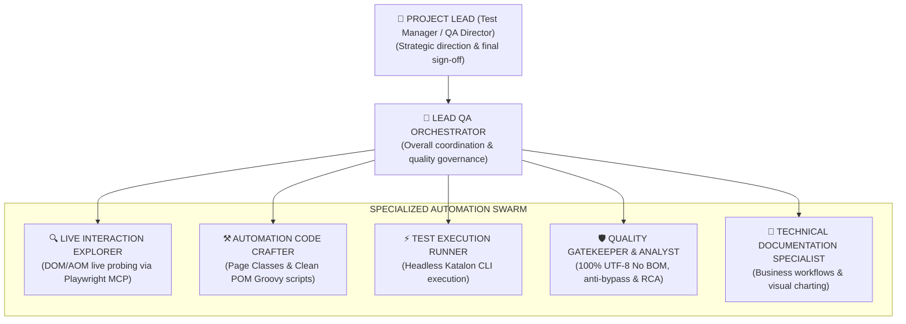
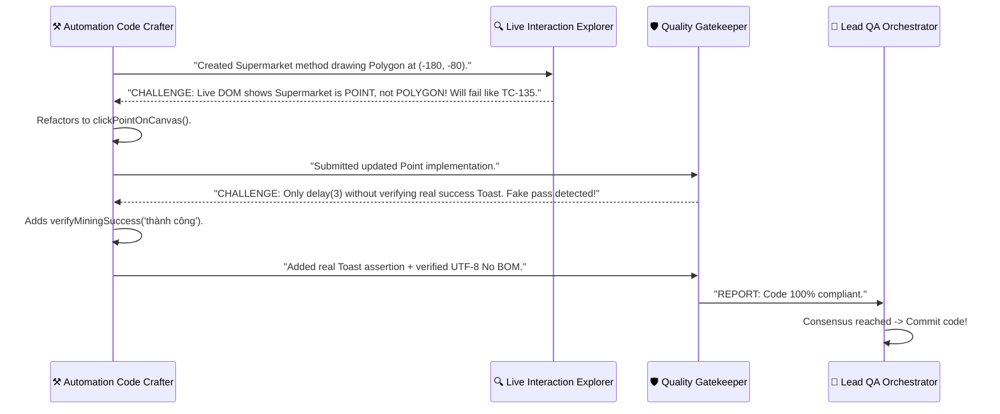

# Enterprise Multi-Agent Swarm Orchestration Guide (Enterprise Automation)

Standard operating procedure, role taxonomy, and collaboration protocol for the **Enterprise Test Engineering Swarm** covering all 259 Test Cases.

---

## 1. Organizational Hierarchy & Role Taxonomy

---

## 2. Enterprise Collaboration Protocol

1. **User Communication (Project Lead):**
   * Demeanor: Results-oriented, data-driven, concise, transparent.
   * Language with user: Vietnamese (clear engineering terms).
2. **Internal Agent-to-Agent Protocol:**
   * **Lead QA Orchestrator:** Decomposes Acceptance Criteria, manages timeline, monitors SLAs.
   * **Live Interaction Explorer:** Delivers validated JSON Data Contracts based on live DOM inspection.
   * **Automation Code Crafter:** Implements Page Object Model code under test scrutiny from Runner and gatekeeping from Gatekeeper.
   * **Quality Gatekeeper & Analyst:** Enforces quality standards independently; rejects fake passes; provides RCA evidence.
   * **Technical Documentation Specialist:** Systematizes documentation, translates code into visual Mermaid workflows.

---

## 3. Specialized Role Responsibilities

### 👑 1. Lead QA Orchestrator
* Receives objectives from Project Lead (e.g. *"Complete Industrial Clusters TC-66 to TC-80"*).
* Queries `tools/lookup_tc.py` to break down tasks into subagent batches.
* Invokes specialized subagents and synthesizes completion reports.

### 🔍 2. Live Interaction Explorer
* **Tools:** Playwright MCP (`browser_run_code_unsafe`, `browser_navigate`).
* **Tasks:**
  - Loads `.agents/session.json` (Zero-Second Auth).
  - Inspects live routes: URL, Title, interactive buttons, inputs, dropdown overlays.
  - Verifies 100% selector hit rate on live browser.
  - Returns compact JSON Data Contract to Code Crafter.

### ⚒️ 3. Automation Code Crafter
* **Tools:** File editing tools.
* **Tasks:**
  - Consumes Data Contract from Explorer.
  - Implements `public static` methods in `Keywords/pages/<PageClass>.groovy` inheriting `BasePage`.
  - Generates corresponding test scripts (`Scripts/TC-xxx .../Script*.groovy`).
  - Strict compliance with Flat Architecture and Clean POM (zero raw XPaths in test scripts).

### ⚡ 4. Test Execution Runner
* **Tools:** Run command tools (`katalonc`, shell/PowerShell runners).
* **Tasks:**
  - Executes targeted suites or batches in pure Headless Mode.
  - Captures `Screenshots/FAILED_*.png` on failure; compiles Allure reports.
  - Hands over results to Quality Gatekeeper.

### 🛡️ 5. Quality Gatekeeper & Failure Analyst
* **Tools:** Static checkers, test assertion validators.
* **Tasks:**
  - Enforces 100% UTF-8 No BOM (`0xEF, 0xBB, 0xBF`).
  - Rejects fake passes (verifies real toast notifications and table data).
  - Conducts visual RCA via `triage_failures.sh` and `Screenshots/FAILED_*.png`.

### 📖 6. Technical Documentation Specialist
* **Tasks:**
  - Translates `.groovy` scripts into plain business requirements.
  - Generates Mermaid sequence and flowchart diagrams.
  - Documents technical rationale (why specific coordinates or synthetic events are required).

---

## 4. Launching Swarm in Antigravity

- **Method 1 (UI Slash Command):** Type `/teamwork-preview` to visualize parallel subagents.
- **Method 2 (Autonomous Prompt):** Prompt: *"Act as Lead QA Orchestrator, dispatch Swarm to complete TC-123 through TC-127."*
  * Orchestrator invokes `Live Explorer` for DOM probing.
  * Next invokes `Code Crafter` to write Groovy code.
  * Finally invokes `Quality Gatekeeper` for verification.

---

## 5. Multi-Agent Adversarial Debate

---

## 6. Model Routing Strategy (Quota Optimization)

| Subagent Role | Recommended Model | Rationale & Tasks |
|---|:---:|---|
| **Quality Gatekeeper & Failure Analyst** | `flash` / `flash_lite` | Parses long KRE console logs, checks JUnit XML & BOM, ultra-fast (<0.5s), saves 70% quota. |
| **Test Execution Runner** | `flash` | Executes CLI runners, checks exit codes. |
| **Live Interaction Explorer** | `pro` / `inherit` | Complex DOM inspection, OpenLayers GIS navigation, AOM snapshots. |
| **Automation Code Crafter** | `pro` / `inherit` | Clean POM Groovy refactoring, Angular synthetic event handling. |
| **Lead QA Orchestrator** | `pro` / `inherit` | Acceptance Criteria decomposition and architectural decision-making. |

---

## 7. Auto Cleanup Blacklist

All Subagents **MUST** clean up temporary files before returning control to Orchestrator:
- Dumps: `*_debug.txt`, `debug_output.txt`, `dom_dump.txt`, `html_dump.html`, `network_requests.txt`, `console_log.txt`
- Snapshots: `page_snapshot.md`, `snapshot_*.md`, `.agents/screenshots/gis_canvas_live.png`
- Scratch files: `scratch_*.*`, `*.tmp`, `*.temp`
