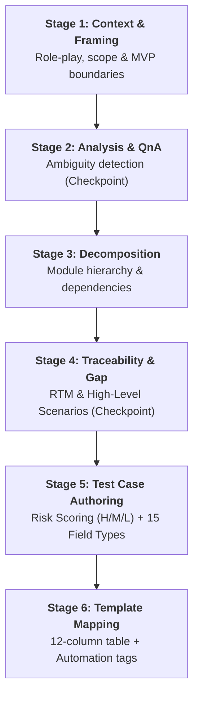

# RBT Manual Testing (AI-Driven Risk-Based Testing Engine)

## 1. Overview & Capabilities

**RBT Manual Testing** is an enterprise-grade skill for designing manual test suites using **Risk-Based Testing (RBT)** and coverage matrix analysis. It provides two operational modes:

| Mode | When to Use | Scope & Characteristics | Execution Time |
| :--- | :--- | :--- | :--- |
| **QUICK Mode** | Standalone modules, simple forms, unambiguous specs | Single-pass generation with EP/BVA coverage | Fast (~1-2 min) |
| **FULL RBT Mode** | Enterprise workflows, complex business rules, high risk | 6-stage sequential pipeline with checkpoints for Ambiguity & RTM | Thorough & structured |

### Core Tenets:
1. **Human Strategy:** Engineers define business boundaries, risk appetite, and resolve flagged ambiguities.
2. **AI Execution:** Agent decomposes modules, builds coverage matrices, applies the 15-field validation checklist, and computes risk scores.
3. **Enterprise Deliverables:** Standardized 12-column Markdown tables with automation metadata, ready for export to Excel (`.xlsx`), Jira Xray, or TestRail.

---

## 2. Mode Routing

- **Trigger QUICK Mode:**
  - "quick test cases", "generate test cases for registration form", "generate test cases from requirement".
  - Small scope (single screen, isolated dialog), clear requirements.
- **Trigger FULL RBT Mode:**
  - "/generate_manual_testcases_rbt", "6-step RBT process", "risk-based test plan", "comprehensive manual suite".
  - Complex multi-step flows, cross-module dependencies, or audit requirements.

---

## 3. Mode 1: QUICK Mode (Fast Single-Pass)

1. **Requirement Analysis:** Map Happy Paths, Negative Paths, Boundary Conditions, and Edge Cases.
2. **Test Design Techniques:**
   - **Equivalence Partitioning (EP):** Partition valid and invalid input classes.
   - **Boundary Value Analysis (BVA):** Evaluate `Min-1`, `Min`, `Min+1`, `Max-1`, `Max`, `Max+1`.
   - **Decision Table:** Combinatorial matrix for multi-conditional business rules.
   - **State Transition:** Sequence of object lifecycle states (`Draft` -> `Pending` -> `Approved`).
3. **Field-Level Validation:** Generate dedicated validation cases for each form input using the 15-field checklist.
4. **Standard Markdown Export:** Format output into the standard 12-column table with automation tags.

---

## 4. Mode 2: FULL RBT (6-Stage Sequential Pipeline)



### Stage 1: Context & Framing
- Identify target system goals, user personas, testing standards, and release scope (MVP vs Full).
- Confirm understanding with the user before proceeding.

### Stage 2: Analysis & Ambiguity Q&A
- Map business paths: Happy Path, Alternate Paths, Exception Paths.
- Detect ambiguities: missing rules, contradictions, undefined error messages, missing timeouts.
- Format numbered Q&A table (`Q1, Q2, Q3...`) with context and proposed assumptions.
- 🛑 **Checkpoint:** Pause and wait for user/stakeholder response before Stage 3.

### Stage 3: System Decomposition
- Decompose system into Modules -> Sub-modules -> Components.
- Map functional dependencies and shared state across modules.

### Stage 4: Traceability Matrix (RTM) & Gap Analysis
- Build Requirements Traceability Matrix linking requirement IDs (`REQ-xxx`) to high-level test scenarios.
- Perform gap analysis to detect uncovered edge cases or orphan flows.
- 🛑 **Checkpoint:** Present scenario outline for user sign-off.

### Stage 5: Detailed Test Case Generation & Risk Scoring
- Assign Risk Level:
  - **High:** Core revenue flows, payment processing, authentication, data loss risks.
  - **Medium:** CRUD operations, table filtering, search, pagination.
  - **Low:** Cosmetic UI, tooltips, static informational content.
- Non-Functional & Resilience Scenarios:
  - **Double Submit / Race Conditions:** Rapid consecutive clicks on submit, concurrent edits.
  - **Network Interruption:** Connection drops mid-transaction.
  - **Browser Navigation:** Browser Back/Forward or page refresh during multi-step wizards.
- Field-Level Validation: Generate dedicated test cases for each input field.

### Stage 6: Template Mapping & Automation Metadata
- Assemble all test cases into the standard 12-column Markdown table.
- Populate automation metadata: `Automatable` (`Yes`/`No`/`Partial`), `Auto Type` (`UI`/`API`/`Unit`/`N/A`), `@Tags` (`@Smoke`, `@Regression`, `@CriticalPath`).

---

## 5. Field-Level Validation Checklist (15 Field Types)

| Field Type | Positive Verification | Boundary & Negative Checks (BVA) | Security & Edge Cases |
| :--- | :--- | :--- | :--- |
| **1. Text (Name, Title)** | Valid length, Unicode support | Empty, leading/trailing whitespace, `Max`, `Max+1` | XSS `<script>`, SQLi `' OR 1=1--`, HTML tags, surrogate emojis |
| **2. Email** | Standard format (`user@domain.com`) | Missing `@`, missing TLD, multiple `@`, spaces | Max 254 characters, Internationalized Domain Names (IDN) |
| **3. Phone** | Standard E.164 or national format | Letters, symbols, too short/long, negative numbers | Leading `+`, spaces, dashes, country code mismatches |
| **4. Password** | Complexity requirements met (Upper, lower, digit, symbol) | Missing criteria, `Min-1`, excessive length | Spaces in password, clipboard paste blocking/support |
| **5. Number (Quantity, Price)** | Integer/float within valid range | Alpha chars, negative values, 0 (if disallowed), decimals | Integer overflow (> 2^31-1), thousands separator formats |
| **6. Date / Datetime** | Valid date format (`YYYY-MM-DD` / `DD/MM/YYYY`) | Invalid calendar dates (Feb 30), leap year checks | Past vs future boundary restrictions, manual input vs picker |
| **7. Date Range** | `StartDate <= EndDate` | `StartDate > EndDate`, single date selected | Same-day range, date span exceeding system max limit |
| **8. Dropdown / Select** | Select valid option, search filter | Unselected mandatory field, empty options list | Async loading delays, large option lists (> 1,000 items) |
| **9. Multi-Select** | Select multiple items, deselect individual | Exceeding max selection limit, Select All | Search filter within list, badge dismissal ("x" click) |
| **10. Checkbox / Radio** | Toggle check/uncheck, switch radio option | Unchecked mandatory consent (Terms of Service) | Rapid toggle spam, disabled read-only state |
| **11. Textarea (Notes, Bio)** | Multi-line text with line breaks | Exceeding character limit, whitespace-only input | Control characters (CRLF, tabs), rich-text paste injection |
| **12. File Upload** | Allowed file format & size limits | Disallowed extension (`.exe`), 0-byte file, oversized file | Special characters in filename, mime-type spoofing |
| **13. OTP / MFA Code** | Valid unexpired code entry | Invalid code, expired code, partial length | Rate limiting (max attempts), resend cooldown timer |
| **14. Range Slider** | Drag slider between Min and Max | Snap-to values, boundary values (`Min`, `Max`) | Keyboard navigation (Arrow keys, Home, End, PageUp/Down) |
| **15. Rich Text Editor** | Bold, italic, bullet lists formatting | Image paste, rich content pasted from external apps | Dangerous HTML tags sanitization, raw character count |

---

## 6. Standard Table Output Specification

All generated test cases must adhere to the 12-column Markdown specification:

```markdown
| TC ID | Module | Risk Level | Test Title | Pre-Condition | Test Steps | Expected Result | Priority | Test Data | Automatable | Auto Type | Tags |
| :--- | :--- | :--- | :--- | :--- | :--- | :--- | :--- | :--- | :--- | :--- | :--- |
| CRM_CUST_TC_001 | Customer | High | Verify create customer with valid data | 1. User logged in as Admin<br>2. On Customer page | 1. Click "New Customer"<br>2. Fill all mandatory fields<br>3. Click "Save" | 1. Alert "Customer added successfully"<br>2. Record visible in customer table | High | Company="AutoCorp", Phone="+123456789" | Yes | UI | @Smoke, @Regression |
```

> **Formatting Invariants:**
> - Numbered test steps and expected results must use `<br>` for multi-line formatting inside table cells.
> - `Risk Level`: `High`, `Medium`, `Low`.
> - `Priority`: `Critical`, `High`, `Medium`, `Low`.

---

## 7. Export to Styled Excel (.xlsx)

Export Markdown test cases directly into styled Excel workbooks via the CLI tool:

```bash
# Convert Markdown table into styled Excel
synapse export-excel path/to/test_cases.md -o output.xlsx --sheet-name "Regression Suite"

# Or via unified CLI dispatcher:
agent-qa export-excel path/to/test_cases.md
```

Generated workbooks automatically include:
- Corporate Navy Blue header styling (`#1F4E78`, bold, white).
- Frozen header pane (`A2`) and enabled `AutoFilter`.
- Color-coded badges for Risk Level and Priority.
- Multi-line text wrapping and optimized column widths.
