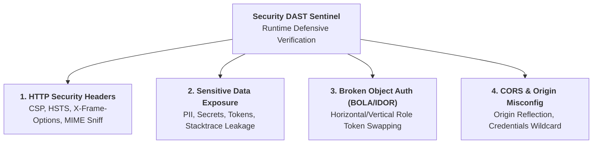

# Security DAST Sentinel (Dynamic Application Security & OWASP Top 10)

> **Purpose:** Automated Dynamic Application Security Testing (DAST) and defensive runtime verification across enterprise web applications and REST/GraphQL APIs. Bridges functional automated testing with OWASP Top 10 defensive compliance gates.

---

## 1. Core Defensive Scope & OWASP Top 10 Coverage



| OWASP Category | Threat Vector | Automated Defensive Check | Assertion Target |
| :--- | :--- | :--- | :--- |
| **A01: Broken Access Control** | BOLA / IDOR | Swapping User A's Bearer token into User B's resource URI | HTTP `403 Forbidden` or `404 Not Found` (Never `200 OK`) |
| **A01: Broken Access Control** | CORS Misconfiguration | Sending unauthorized `Origin` header with `Credentials: include` | Must NOT reflect origin with `Access-Control-Allow-Credentials: true` |
| **A02: Cryptographic Failures** | Insecure Transport & Missing HSTS | Inspecting headers on HTTPS endpoints | `Strict-Transport-Security: max-age=31536000; includeSubDomains` |
| **A05: Security Misconfiguration** | Missing Security Headers | Passive audit on all page navigations & API responses | CSP, X-Frame-Options, X-Content-Type-Options: nosniff |
| **A05: Security Misconfiguration** | Verbose Error Disclosure | Injecting invalid payload to trigger 4xx/5xx | Response must NOT contain `SQLException`, `Traceback`, or internal paths |
| **A09: Security Logging & Monitoring** | Sensitive Data Leakage | Regex scan on API responses and local storage | Zero plaintext passwords, credit cards, or private keys |

---

## 2. HTTP Security Response Headers Audit

All production and staging responses must enforce strict defensive headers to prevent Clickjacking, Cross-Site Scripting (XSS), and MIME-sniffing attacks.

### Mandatory Security Header Policy
1. `Content-Security-Policy`: Must define `default-src 'self'` or restrictive directive; must avoid `'unsafe-eval'` or open wildcards `*` in script sources.
2. `Strict-Transport-Security`: `max-age=31536000; includeSubDomains` on HTTPS.
3. `X-Frame-Options`: `DENY` or `SAMEORIGIN` (prevents UI clickjacking in external iframes).
4. `X-Content-Type-Options`: `nosniff` (prevents browser MIME-type confusion).
5. `Referrer-Policy`: `strict-origin-when-cross-origin` or `no-referrer`.
6. `Permissions-Policy`: Restricts camera, microphone, and geolocation APIs.

### Playwright Automated Headers Fixture (TypeScript)
```typescript
import { test, expect } from '@playwright/test';

test.describe('DAST Security Headers Audit', () => {
  test('verify mandatory security headers on target application', async ({ page }) => {
    const response = await page.goto('/dashboard');
    expect(response).not.toBeNull();
    const headers = response!.headers();

    // 1. Clickjacking Protection
    const xFrame = headers['x-frame-options']?.toUpperCase();
    expect(['DENY', 'SAMEORIGIN'], 'X-Frame-Options must be DENY or SAMEORIGIN').toContain(xFrame);

    // 2. MIME Sniffing Protection
    expect(headers['x-content-type-options'], 'Must prevent MIME sniffing').toBe('nosniff');

    // 3. Strict Transport Security
    if (page.url().startsWith('https://')) {
      expect(headers['strict-transport-security'], 'HSTS must be enabled on HTTPS').toContain('max-age=');
    }

    // 4. Content Security Policy
    const csp = headers['content-security-policy'];
    expect(csp, 'Content-Security-Policy must be declared').toBeTruthy();
    expect(csp).not.toContain("default-src *");
  });
});
```

---

## 3. Sensitive Data Exposure (PII, Secrets & Error Leakage)

API responses and client-side storage must never leak internal stack traces, system paths, unmasked PII, or authorization credentials.

### Automated Response Interceptor Linter (Python / Playwright)
```python
import re
from typing import Dict, List

# Patterns matching accidental secret or stacktrace leakage
SENSITIVE_LEAK_PATTERNS = [
    (re.compile(r'-----BEGIN (?:RSA )?PRIVATE KEY-----'), "Exposed Private Key"),
    (re.compile(r'(?i)\b(?:password|passwd|pwd)\b\s*[:=]\s*["\'][^"\']{4,}["\']'), "Exposed Plaintext Password"),
    (re.compile(r'\b(?:4[0-9]{12}(?:[0-9]{3})?|5[1-5][0-9]{14})\b'), "Raw Credit Card Number (Visa/MC)"),
    (re.compile(r'(?i)(?:SQLException|HibernateException|org\.postgresql\.util|java\.lang\.NullPointerException)'), "Database Stacktrace Leak"),
    (re.compile(r'(?i)(?:Traceback \(most recent call last\)|File "[a-zA-Z0-9_\-\\/]+\.py", line \d+)'), "Python Stacktrace Leak"),
    (re.compile(r'\b[a-zA-Z]:\\[a-zA-Z0-9_.\-\\]+\b'), "Internal Windows File Path Leak"),
]

def scan_response_for_leaks(body_text: str) -> List[str]:
    """Inspects API response text for prohibited sensitive data leaks."""
    violations = []
    for pattern, description in SENSITIVE_LEAK_PATTERNS:
        if pattern.search(body_text):
            violations.append(description)
    return violations
```

---

## 4. Broken Object-Level Authorization (BOLA / IDOR) Testing

BOLA occurs when an API endpoint uses user-supplied IDs to retrieve object instances without validating user ownership.

### Automated Dual-Role Permutation Protocol
1. **User A (Victim):** Log in and create Entity `X` (ID: `10042`).
2. **User B (Attacker):** Log in as an unrelated user or tenant, acquire Token `B`.
3. **Execute Cross-Tenant Query:** Dispatch `GET /api/v1/entities/10042` with `Authorization: Bearer <Token_B>`.
4. **Assert Access Barrier:**
   - `HTTP 403 Forbidden` or `HTTP 404 Not Found` => **PASS** (Zero BOLA).
   - `HTTP 200 OK` with Entity `X` payload => **CRITICAL DEFECT: BOLA / IDOR VULNERABILITY**.

```typescript
test('BOLA Defense: Tenant B cannot access Tenant A entity', async ({ request }) => {
  // Tenant A creates resource
  const createRes = await request.post('/api/v1/invoices', {
    headers: { 'Authorization': `Bearer ${tokenTenantA}` },
    data: { amount: 5000, description: 'Confidential Invoice A' }
  });
  const invoiceId = (await createRes.json()).id;

  // Tenant B attempts to read Tenant A's invoice
  const readAttempt = await request.get(`/api/v1/invoices/${invoiceId}`, {
    headers: { 'Authorization': `Bearer ${tokenTenantB}` }
  });

  // Assertion: System must block cross-tenant read
  expect([403, 404], 'Tenant B must not access Tenant A invoice').toContain(readAttempt.status());
});
```

---

## 5. CORS Misconfiguration Audit

CORS policies must never reflect arbitrary untrusted origins when credentials (cookies/tokens) are supported.

```typescript
test('CORS Defense: Server must not reflect arbitrary untrusted Origin with credentials', async ({ request }) => {
  const untrustedOrigin = 'https://untrusted-attacker.com';
  const response = await request.get('/api/v1/user/profile', {
    headers: {
      'Origin': untrustedOrigin,
      'Authorization': `Bearer ${validUserToken}`
    }
  });

  const allowOrigin = response.headers()['access-control-allow-origin'];
  const allowCredentials = response.headers()['access-control-allow-credentials'];

  // Critical CORS Flaw: Reflecting untrusted origin while allowing credentials
  if (allowOrigin === untrustedOrigin && allowCredentials === 'true') {
    throw new Error('CRITICAL CORS VULNERABILITY: Arbitrary origin reflection with credentials enabled');
  }

  // Critical CORS Flaw: Wildcard with credentials
  if (allowOrigin === '*' && allowCredentials === 'true') {
    throw new Error('CRITICAL CORS VULNERABILITY: Wildcard origin with credentials enabled');
  }
});
```

---

## 6. Security DoD Verification Checklist
- [ ] Mandatory security headers verified on root and core dashboard routes.
- [ ] No `500 Server Error` response contains raw SQL exceptions or language stacktraces.
- [ ] All ID-based mutation and query endpoints verified against BOLA/IDOR permutations.
- [ ] CORS policies enforce whitelist or block `Credentials: true` with arbitrary origins.
- [ ] All security testing conducted non-destructively in defensive QA test suites.
