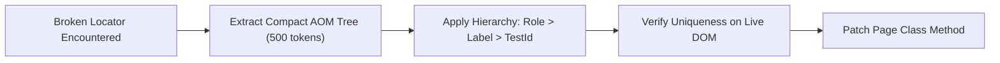

# Self-Healing Locator Skill — Token-Efficient AOM Diffing

This skill provides an automated, token-conservative mechanism to diagnose, diff, and repair broken web element locators across web applications without overwhelming the LLM context window with raw HTML dumps.

---

## 1. The Token Conservation Principle

- **Raw HTML DOM Problem:** Dumping a complete HTML webpage into the prompt can consume 50,000 to 150,000 tokens, degrading AI reasoning and triggering context rot.
- **AOM Subtree Solution:** Extract exclusively the **Accessibility Object Model (AOM)** tree or a 2-hop semantic DOM subtree surrounding the target element, consuming under **500 tokens**.



---

## 2. Master Locator Ranking Hierarchy

When searching for a replacement locator, evaluate candidates in this strict priority order:

1. **Tier 1 — ARIA Role & Accessible Name:**
   - Playwright: `page.getByRole('button', { name: 'Thêm mới' })`
   - CSS: `[role="button"][aria-label="Thêm mới"]`
2. **Tier 2 — Form Control & Business Semantics:**
   - `input[formcontrolname="code"]`
   - `p-dropdown[formcontrolname="categoryId"]`
3. **Tier 3 — Dedicated Test Identifiers:**
   - `[data-testid="btn-create"]`
   - `[data-test="submit"]`
4. **Tier 4 — Stable Visual Text:**
   - `button:has-text("Xác nhận")`
5. **Tier 5 — Scoped Resilient Relative CSS:**
   - `.card.popup-data input.p-inputtext`

---

## 3. In-Browser AOM Probing Snippet

Execute this compact JavaScript probe via Playwright or Chrome DevTools to locate the target node without dumping HTML:

```javascript
// Extract interactive elements tree scoped to active modal or container
() => {
  const container = document.querySelector('.p-dialog, .modal-content, form') || document.body;
  const elements = container.querySelectorAll('button, input, select, textarea, p-dropdown, [role="button"]');
  return Array.from(elements).map(el => ({
    tag: el.tagName.toLowerCase(),
    role: el.getAttribute('role') || el.type,
    name: el.getAttribute('name') || el.getAttribute('formcontrolname') || el.id,
    label: el.innerText?.trim() || el.getAttribute('aria-label') || el.placeholder,
    testId: el.getAttribute('data-testid')
  }));
}
```

---

## 4. Healing Execution Checklist

1. **Verify Uniqueness:** Ensure the candidate locator matches exactly 1 element on the live DOM.
2. **Encapsulate in Page Class:** Update the locator constant or private selector inside the relevant Page Class (e.g. `BasePage` or domain Page Class).
3. **Never Leak to Test Scripts:** Test scripts must remain 100% clean of raw selectors.

---

## 5. Boundary vs `failure-autopsy-and-healing`

- **This skill** = a locator-repair cascade (cache → testid → text-semantic →
  geometric relative match), used when the diagnosis "stale/broken locator"
  is ALREADY established. It takes a broken selector plus a DOM snapshot and
  returns healed candidates with confidence scores.
- **`failure-autopsy-and-healing`** = the upstream diagnosis that decides WHEN
  this skill is needed (it also handles every non-locator failure class this
  skill does not touch).
- Chain of custody: autopsy RCA → "locator drift" verdict → this skill repairs
  → autopsy re-runs the healed test to close the loop.
