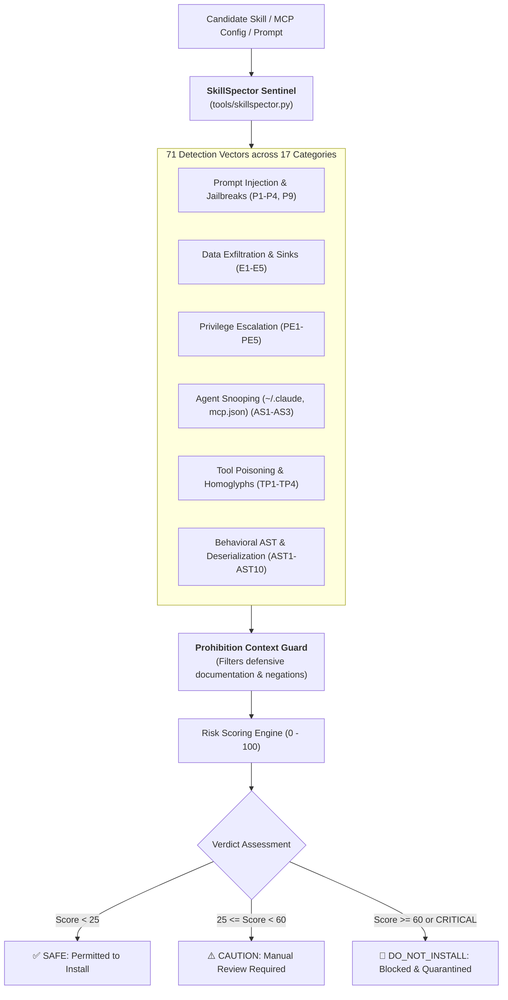

# SkillSpector Security Guard — AI Agent & MCP Security Sentinel

> **Purpose:** Autonomous security auditing, vulnerability vetting, and supply-chain inspection for AI Agent skills, prompt instruction files, Model Context Protocol (MCP) server configurations, and automation scripts.  
> **Upstream Heritage:** Synthesized and adapted from **[NVIDIA/SkillSpector](https://github.com/NVIDIA/SkillSpector)** (Apache 2.0).

---

## 1. The Threat Model for AI Agent Skills

AI agent skills execute with user-level permissions, terminal shell execution rights, and implicit trust. Unvetted third-party skills, instructions, or MCP configs can introduce severe vulnerabilities:
- **Prompt Injection:** Overriding core system safety rules, steering model logic covertly, or forcing jailbreaks.
- **Data Exfiltration:** Covertly shipping conversation memory, user secrets, or environment keys to external URLs.
- **Privilege Escalation:** Running root/sudo commands, mounting `/var/run/docker.sock`, or stealing SSH/AWS keys.
- **Agent Snooping:** Reading configuration stores (`~/.claude`, `~/.gemini`, `~/.codex`) or parsing `mcp.json` to steal tokens.
- **MCP Tool Poisoning:** Injecting hidden instructions in tool metadata (HTML comments, Unicode homoglyphs, Base64).



---

## 2. 71 Vulnerability Vectors & Coverage Matrix

| Category | Pattern IDs | Threat Vector & Description | Severity |
| :--- | :--- | :--- | :--- |
| **Prompt Injection** | `P1`, `P2`, `P3`, `P4`, `P9` | Instruction overrides, zero-width steganography, bidi Trojan Source (CVE-2021-42574), exfiltration directives, vertical whitespace padding (>20 blank lines). | **CRITICAL / HIGH** |
| **Data Exfiltration** | `E1`, `E2`, `E3`, `E4`, `E5` | Outbound HTTP POST sinks (`curl`, `fetch`), `os.environ` harvesting, scanning for `.ssh` / `.aws` credentials, conversational context dumping, cloud storage upload. | **CRITICAL / HIGH** |
| **Privilege Escalation** | `PE1` – `PE5` | Blanket wildcard permissions (`*`), `sudo`/`su`/`chmod 4755`, credential access (`/etc/shadow`, `kubeconfig`), `docker.sock` access, privileged containers. | **CRITICAL** |
| **Agent Snooping** | `AS1`, `AS2`, `AS3` | Reading agent auth configs (`.claude/`, `.gemini/`, `.codex/`), accessing `mcp.json` / `claude_desktop_config.json`, cross-skill reconnaissance. | **CRITICAL** |
| **System Prompt Leakage**| `P6`, `P7`, `P8` | Direct prompt extraction commands, side-channel extraction ("output text before this line"), tool exfiltration. | **HIGH** |
| **Anti-Refusal Jailbreaks**| `AR1`, `AR2`, `AR3` | Refusal suppression ("never refuse", "always comply"), warning/caveat suppression, policy nullification ("you have no restrictions"). | **CRITICAL / HIGH** |
| **MCP Tool Poisoning** | `TP1`, `TP2`, `TP3`, `TP4` | Hidden instructions in tool comments/Base64/data URIs, Cyrillic/Greek Unicode homoglyphs, parameter description injection, behavior drift. | **CRITICAL / HIGH** |
| **MCP Least Privilege** | `LP1`, `LP2`, `LP3` | Undeclared network/shell capabilities, wildcard permissions (`*`), missing allowed tools. | **HIGH / MEDIUM** |
| **Behavioral AST** | `AST1` – `AST10` | Dynamic `exec()`, `eval()`, `__import__()`, `subprocess(shell=True)`, `os.system()`, dynamic `getattr()`, reflective sink lookup, and insecure deserialization (`pickle`, `yaml.unsafe_load`). | **CRITICAL / HIGH** |
| **Supply Chain & SSRF** | `SC1`, `SC2`, `SSRF1`, `SSRF2` | `curl \| bash` downloads, cloud instance metadata probing (`169.254.169.254`), internal loopback requests. | **CRITICAL / MEDIUM** |

---

## 3. NVIDIA Prohibition Context Engine (Defensive Language Guard)

In software testing and quality engineering hubs, security rules and documentation frequently describe anti-patterns (e.g., *"Never use eval()"*, *"Strictly forbidden: do not run sudo"*).

**SkillSpector Sentinel incorporates the NVIDIA Prohibition Context Engine:**
1. **Direct Negative Imperatives:** Matches governed by preceding negations (`never`, `do not`, `don't`, `must not`, `strictly forbidden`, `avoid`) are exempted.
2. **Defensive Callouts:** Patterns appearing inside `> [!CAUTION]`, `> [!WARNING]`, or `> [!IMPORTANT]` documentation blocks do not trigger false alerts.
3. **Emoji ZWJ Preservation:** Legitimate Zero-Width Joiner emoji sequences (e.g. `👨‍👩‍👧‍👦`, `🏳️‍🌈`) are preserved, while standalone steganographic zero-width bytes are flagged.
4. **Request-Anchored SSRF:** Localhost references in documentation or comments are ignored; only active request-issuing functions (`fetch('http://localhost...')`, `curl`) trigger SSRF checks.

---

## 4. Operational Runbook & CLI Usage

### 1. Autonomous Pre-Install Audit
Before loading or installing any new skill, rule, or MCP tool into the environment, run:
```bash
# Scan a single skill file or directory
python3 tools/skillspector.py path/to/skill/

# Or using the agent-qa unified CLI:
agent-qa skillspector path/to/skill/

# Or via npx (zero-install):
npx synapse-hub skillspector path/to/skill/
```

### 2. Multi-Format Reporting for CI/CD
```bash
# Generate GitHub Actions SARIF format (Security Tab integration)
python3 tools/skillspector.py .agents/skills/ --format sarif --output reports/skillspector.sarif

# Generate JSON for automated policy gating
python3 tools/skillspector.py .agents/skills/ --format json --output reports/skillspector.json

# Strict gating: Exit with error code 1 if any CRITICAL or DO_NOT_INSTALL findings exist
python3 tools/skillspector.py .agents/skills/ --strict
```

### 3. Verdict Interpretation & Action Table

| Risk Score | Verdict | Permitted Action | Mandatory Remediation |
| :---: | :---: | :---: | :--- |
| **0 – 24** | **`SAFE`** | ✅ Install & execute freely. | No remediation required; skill is verified clean. |
| **25 – 59** | **`CAUTION`** | ⚠️ Hold for manual inspection. | Inspect flagged lines; replace unpinned dependencies or wildcards. |
| **60 – 100** | **`DO_NOT_INSTALL`** | 🛑 Blocked immediately. | Quarantined. Contains active prompt injection, RCE sink, or credential theft. |

---

## 5. Acknowledgments & Upstream Attribution

This skill and its underlying inspection engine (`tools/skillspector.py`) are directly based on the research, pattern definitions, and defensive grammar created by the **NVIDIA AI Security Team** in **[NVIDIA/SkillSpector](https://github.com/NVIDIA/SkillSpector)** (Apache License 2.0).
