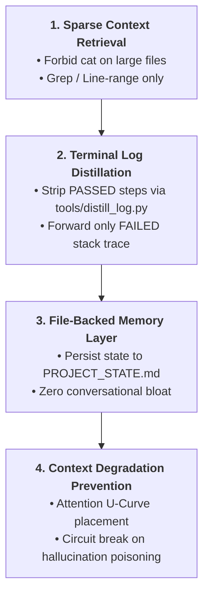

# Token & Context Optimizer — Antigravity Engineering Standard

> **Purpose:** Master context engineering and token efficiency. Directs AI Agents to prevent context rot, mitigate Lost-in-the-Middle attention drops, offload large state to filesystem scratchpads, and maintain clean KV-cache alignment across long test automation sessions.

---

## 1. The Core Context Architecture



---

## 2. Protocol 1: Sparse Context Retrieval

- **Rule:** Never read entire source files exceeding 150 lines into active context.
- **Enforcement:**
  - Prohibit commands like `cat`, `type`, or unbounded `read_file` on large Page Classes (e.g. `DataMiningPage.groovy`).
  - Use regex search (`grep -n`, `ripgrep`) or compressed maps (`tools/repo_map.txt`) to pinpoint signatures.
  - Read strictly the targeted 20–50 lines using `StartLine` and `EndLine` parameters.

---

## 3. Protocol 2: Terminal Log Distiller (`tools/distill_log.py`)

- **Rule:** Never dump unparsed execution logs (KRE CLI, Playwright stdout, Gradle) into the active conversation.
- **Enforcement:**
  - Automatically filter out passing step messages, INFO logs, and JVM loading notices.
  - Forward strictly the distilled failure block:
    ```text
    [FAILED] TC-xxx at Line <LineNumber>
    Exception: <ExceptionName> (<Message>)
    [Full raw log saved to file://<path>; verbose lines omitted]
    ```

---

## 4. Protocol 3: Task Scratchpad & File-Backed Context

- **Rule:** Do not accumulate large session state, test case inventories, or defect logs inside conversational prompt turns.
- **Enforcement:**
  - Use the filesystem as the primary overflow memory layer.
  - Persist ephemeral task tracking and defect registers to disk in structured markdown files (e.g. `PROJECT_STATE.md`, `KNOWN_ISSUES.md`, or `<appDataDir>/brain/<id>/scratch/`).
  - Prefer dynamic context discovery (pulling context on demand via search tools) over static bulk inclusion.

---

## 5. Protocol 4: Mitigating Context Degradation & Lost-in-the-Middle

- **Attention U-Curve Principle:** Models recall information at the beginning (BOS / System Prompt) and end (latest turn) far better than information buried in the middle of long sessions (> 4,000 tokens).
- **Enforcement:**
  - Place critical instructions and current objective anchors at the beginning and end of prompts.
  - Segment multi-module tasks into discrete sub-agent scopes to prevent cross-task confusion.
  - **Context Poisoning Circuit Breaker:** If a tool output or test run produces an invalid assumption or hallucination, truncate reasoning immediately and re-anchor against verified disk state rather than compounding false premises.

---

## 6. Protocol 5: KV-Cache Friendly Ordering
- Maintain immutable static instruction prefixes at the top.
- Append new dynamic observations strictly at the bottom.
- Use uniform pre-flight header formats to achieve > 85% inference KV-cache hit rate.
