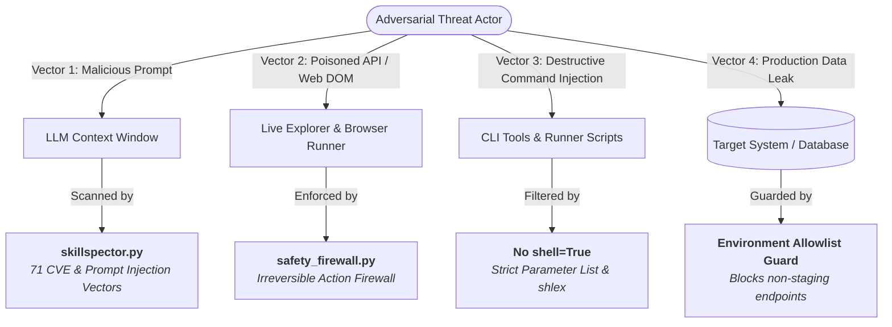

# Security Policy & Threat Model — Synapse Hub

> **Project:** Synapse Hub — Decoupled Enterprise AI Agent QA & Automation Hub  
> **Author & Copyright Holder:** Thế Vị (@TeeVee998)  
> **License:** MIT License  

---

## 1. Supported Versions

We actively support and release security patches for the following versions:

| Version | Supported | Security Maintenance Status |
| :--- | :---: | :--- |
| `2.2.x` | ✅ | Current Stable Release (Active Maintenance & Zero-Day Patching) |
| `2.1.x` | ⚠️ | Critical Security Fixes Only |
| `< 2.0.0` | ❌ | End of Life (Deprecated) |

---

## 2. Threat Model & Security Architecture

Synapse Hub operates as a decoupled shared intelligence core across host systems, CI/CD runners, and AI agent sandboxes (Google Antigravity, Cursor, Claude Code, GitHub Copilot, Windsurf). The following threat matrix outlines our primary attack vectors, impact boundaries, and built-in defenses.

### 2.1 Attack Vectors & Mitigations

| Threat Vector | Potential Impact | Defensive Layer & Built-in Mitigation |
| :--- | :--- | :--- |
| **Prompt Injection & Indirect Jailbreaks** | LLM hijacking via poisoned web pages or untrusted user stories. | **`tools/skillspector.py` + Skill #28 (`skillspector-security-guard`):** 71 detection rules modeled after NVIDIA SkillSpector, scanning for prompt injection, jailbreaks, and cross-session instruction manipulation. |
| **Destructive Browser & CLI Commands** | Agent executing irreversible operations (`rm -rf`, `DROP TABLE`, destructive API calls). | **`tools/safety_firewall.py`:** Intercepts browser actions and CLI calls; blocks drop/truncate/delete queries without `WHERE` clauses and destructive OS commands. |
| **Accidental Production Data Mutation** | Fuzzing or test data injection corrupting live production databases. | **Environment Allowlist Guard:** Embedded in `tools/api_fuzzer.py` and `tools/trace_data_flow.py`. Prohibits execution against non-staging/non-localhost domains unless explicitly confirmed via `SYNAPSE_ALLOW_PROD_FUZZ=1`. |
| **Credential & Secret Leakage** | Committing bearer tokens, private keys, or passwords to git repositories. | **DoD Gate 6 (`tools/verify_all.py`):** Pre-commit and pre-push regex scans detect JWTs, AWS keys, private SSH keys, and plaintext passwords across the entire codebase. |
| **Arbitrary Code Execution via CLI Shells** | OS command injection via unescaped string concatenation. | **Zero `shell=True` Policy:** All subprocess invocations use structured parameter lists or `shlex.split()`. Zero instances of raw `shell=True` exist in `tools/*.py`. |
| **Source File Corruption via AST Mutators** | Incomplete micro-mutation runs leaving mutated test scripts in place. | **Atomic Backup & Rollback (`.synapse_mutator_bak`):** `tools/micro_mutator.py` wraps file modifications in `try/finally` blocks with cryptographic md5 verification and atomic restoration. |
| **Author Attribution Tampering & Anti-Piracy** | Stripping license notices or falsifying authorship to distribute backdoored variants. | **DoD Gate 0 (`tools/verify_all.py`):** Cryptographic SHA-256 integrity check and mandatory MIT license provenance verification for Thế Vị (@TeeVee998). |

---

## 3. Reporting a Vulnerability

We appreciate the responsible security research community and treat all vulnerability reports with the highest priority.

### 3.1 Reporting Channel
- **Private Vulnerability Reporting:** Submit details via [GitHub Private Vulnerability Reporting](https://github.com/TeeVee998/Synapse-Hub/security/advisories/new).
- **Direct Security Contact:** Reach out directly to the primary maintainer at `vpham295998@gmail.com` with the subject tag `[SECURITY VULNERABILITY] Synapse-Hub`.

### 3.2 Submission Guidelines
Please include:
1. Description of the vulnerability and affected tool/skill.
2. Step-by-step reproduction instructions or Proof-of-Concept (PoC) script.
3. Potential impact assessment according to the CVSS v3.1 standard.
4. Suggested remediation or patch if available.

### 3.3 Response SLAs
- **Initial Acknowledgment:** Within **24 hours**.
- **Triage & Severity Assessment:** Within **48 hours**.
- **Fix & Coordinated Disclosure:** Within **14 business days** (critical zero-days remediated within 72 hours).

---

## 4. Release Integrity & Supply Chain Provenance

1. **SLSA & GitHub Attestations:** Official npm and GitHub releases include build attestations and artifact provenance (SLSA Level 2 compliant).
2. **Deterministic Manifests:** All skills and tools are indexed in `skills_manifest.json` with version pinning and checksum validation.
3. **No External Network Dependencies at Runtime:** The core QA verification toolkit operates 100% offline without downloading arbitrary npm/python scripts at runtime.
