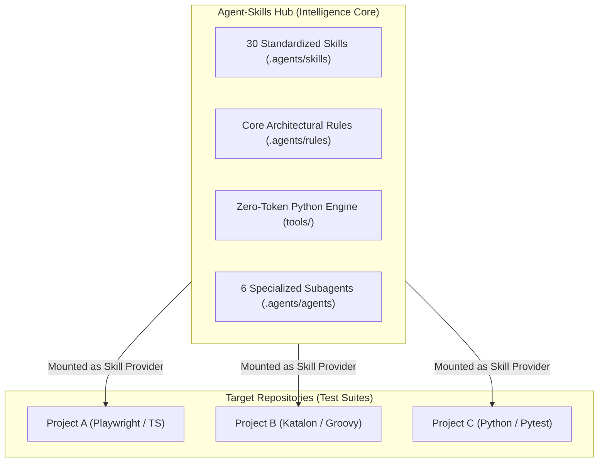
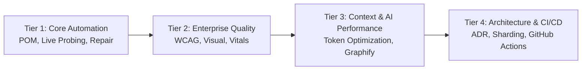

# Agent-Skills Architecture & Design Principles

> **Scope:** Enterprise Multi-Agent QA Hub  
> **Version:** `2.1.1` | **Status:** Active / Production Standard

---

## 1. Hub & Spoke Operating Model

The `agent-skills` repository functions as a centralized **Intelligence Core (Hub)** decoupled from target test repositories (**Spokes**). 

### Architectural Benefits:
1. **Zero Context Contagion:** Target project repositories stay clean and focused strictly on test cases and Page Classes, without polluting git trees with heavy AI agent instructions.
2. **Instant Upgradability:** Improvements to self-healing algorithms, token compressors, and lint rules propagate globally to all target projects instantly.
3. **Intellectual Property Isolation by Architecture:** Because `agent-skills` is a decoupled, standalone repository, target projects remain 100% clean without requiring complex dual-remote mirroring or `smart_push` scripts. Developers and agents push directly to company SCM for target projects, and to the central hub for skills.

---

## 2. Four-Tier Skill Stratification

The 27 skills in the hub are structured into four progressive operational tiers:

1. **Tier 1 — Core Automation & Self-Healing:**
   - Script generation, Clean POM flat architecture, live DOM probing via Playwright MCP, and in-place locator healing.
2. **Tier 2 — Enterprise Quality Sentinel:**
   - Accessibility audits (WCAG 2.2), Core Web Vitals profiling, visual regression comparisons, and synthetic data generation.
3. **Tier 3 — AI Context Engineering & Diagnostics:**
   - Attention-pattern protection, context degradation countermeasures, token optimization, and AST knowledge graph navigation.
4. **Tier 4 — Architecture, CI/CD & Delivery:**
   - Architecture Decision Records (ADRs), code refactoring and technical debt remediation, and containerized GitHub Actions CI/CD pipelines.

---

## 3. Flat Clean POM Architecture Pattern

Test automation scripts orchestrated through this Hub enforce strict Clean POM boundaries:

- **Rule 1 — Zero Selectors in Scripts:** Test scripts (`Scripts/` or `tests/`) must NEVER contain raw XPaths, CSS selectors, or `findTestObject` calls.
- **Rule 2 — Single Inheritance:** All Page Classes inherit from `BasePage`, which standardizes smart waits, dynamic identifiers, and synthetic event dispatchers.
- **Rule 3 — Dynamic Test Data Idempotency:** Every data entity must use dynamic prefixes generated via `BasePage.uniqueCode("PREFIX_")` to eliminate database key collisions during parallel execution.
- **Rule 4 — In-Place Self-Healing:** If an element changes or breaks, only the affected Page Class is updated; test scripts remain untouched.

---

## 4. Multi-Agent Swarm Collaboration Matrix

The Hub equips 6 specialized subagents with scoped tool and skill permissions:

| Subagent Role | Primary Focus | Allowed Skills | Execution Tools |
| :--- | :--- | :--- | :--- |
| **`orchestrator`** | Task decomposition & governance | `agent-orchestration-multi-agent-optimize`, `graphify-impact-analyzer`, `architecture-decision-records`, `token-and-context-optimizer` | `verify_all.py`, `test_impact.py`, `setup_project.py` |
| **`pom-crafter`** | Clean POM design & test generation | `clean-pom-crafter`, `lam-script-generator`, `synthetic-test-data-generator`, `api-spec-to-e2e-matrix` | `lookup_xpath.py`, `repo_map.py`, `generate_tc_from_story.py` |
| **`live-explorer`** | Live DOM & AOM exploration (<200ms) | `playwright-live-interaction`, `self-healing-locator`, `visual-regression-sentinel`, `api-network-mocking-interception` | `browser_helpers.js`, `e2e_flow_prober.ps1`, `safety_firewall.py` |
| **`test-runner`** | Headless CLI test execution & CI | `katalon-cli-runner`, `e2e-testing-patterns`, `flaky-test-sentinel-and-quarantine`, `backend-load-and-stress-patterns`, `github-actions-templates` | `matrix_sharder.py`, `distill_log.py`, `pinpoint_failure.py`, `flaky_detector.py` |
| **`failure-analyst`**| Visual & XML error autopsy | `failure-autopsy-and-healing`, `self-healing-locator`, `file-and-report-validator` | `auto_heal.py`, `heal_pr_automator.py`, `pinpoint_failure.py`, `cache_resolver.py` |
| **`quality-gatekeeper`**| 8 Gates DoD & Fake-Pass Sentinel | `antigravity-test-sentinel`, `code-refactoring-refactor-clean`, `wcag-audit-patterns`, `web-vitals-and-performance-profiler`, `security-dast-sentinel` | `verify_all.py`, `infer_linter.py`, `micro_mutator.py`, `trace_data_flow.py` |
